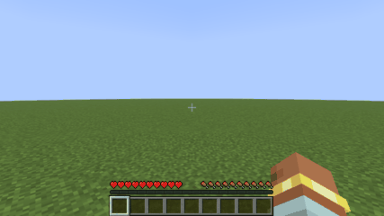

# rustcraft

The Minecraft Java Edition client (26.3), ported to Rust file by file from the decompiled game and checked against the real game at every step.

Created in [T3 Code](https://t3.codes).

## The prompt

This project started from this prompt:

> I want to re-create the Minecraft Client in Rust, wondering if we can setup the environment first.
>
> can we get the decompiled version of Minecraft Java (the latest version), I was thinking of doing a Java to Rust translation, but keeping the Java mannerism (like folder structures and etc).
>
> But i'm also scared of you getting some parts wrong, and even when I tell you to optimize properly, so I'm wondering what we can do here to fix it, maybe screenshots comparison (in a pixel perfect way?), comparing network packets to the original client and maybe even tests from the minecraft server client in C++
>
> what do you think here?

Then, on 2026-10-22, the goal:

> I want to re-create the Minecraft Client in Rust, focus on being able to join a Minecraft Server and rendering the world in a real GUI.
>
> Use the decompiled Minecraft Java in here for reference, and feel free to optimize or using any other library for rendering, like using one that does Metal (the apple thing) directly if possible.
>
> For validation, compare against the real Minecraft Java client, for example joining a test server, comparing if something is pixel perfect overtime (like in a video or a screenshot), opening GUIs, comparing network packets to the original client and see if they match and if needed, use the C++ Minecraft Server tests which focus a lot on physics of a Minecraft Bot client compared to the real thing, and maybe even do some of our own if you want to.
>
> The goal here is to get a better optimized version of the Minecraft Client from Java to Rust, like getting even more FPS while being equal to the Java one in everything. Feel free to have agents that compare each one, and see what's missing, a table in the readme describing the features and how the Rust port compares would be really nice.

## How it fits together

- **The port** lives in `src/`, mirroring Java's packages: `src/net/minecraft/util/mth.rs` is `net/minecraft/util/Mth.java`. [PORTING.md](PORTING.md) has the translation rules, including the places where Java and Rust disagree on numbers.
- **Vanilla is the oracle.** The real game runs alongside the port and the outputs get compared, from single functions up to screenshots. [TESTING.md](TESTING.md) has the layers and file formats.
- **The goal** is in [GOAL.md](GOAL.md): join a server and render the world in a real window, then match vanilla in packets, physics, pixels and screens while running faster. The work runs as parallel tracks (net, world, render, and later player, screens, performance and backends). [PROGRESS.md](PROGRESS.md) logs how far each has come.
- **Mojang's code and assets stay out of git.** `tools/setup_vanilla.py` downloads and decompiles them into `vanilla/`, which is gitignored, because they can't be redistributed. The Rust translation is derived from that code too, so think twice before making this repository public.

## Features

How the port compares with vanilla 26.3, area by area.

Coverage on `main` today (counted from the code and its checks by the comparison agent, 2026-10-23):
- **Gates** (GOAL.md): 2 of 6 reached, gates 1 (join) and 3 (the walk, pixel for pixel). Gate 2's window has the terrain, sky, fog, the HUD's bars, the hand and movement; gate 3's walk passes `oracle-diff dir --strict` live (trace, packets and both screenshots identical), and CI checks its screenshots' digests on the oracle's Mesa; gate 5 is measured (README "Performance"), not yet passed: the port is faster per tick, per compile, to start and in memory, but not yet while chunks load.
- **Packets**: 128 of vanilla's 260 decoded. Handshake 1 of 1, status 4 of 4, login 11 of 11, configuration 29 of 31 (10 of 10 serverbound, 19 of 21 clientbound), play 63 of 144 clientbound and 20 of 69 serverbound. The rest are `Unported`: skipped by their frame, and counted (the soak lists them).
- **Scenarios**: 34 in `oracle/scenarios/`. Offline, the 24 with replay tests (the walk, `walk-video`, `hud-experience`, `pause-no-gui`, `title` and 19 physics scenarios) have vanilla's trace and packets from the marker, in CI. Live, 21 pass `oracle-diff dir --strict` (the walk, `walk-no-gui`, `walk-video`, the three skies, `chat`, `pause-no-gui`, `options-no-gui`, `title`, `screens` and 10 physics scenarios), and `piston-push` has its trace and packets from the marker identical (the server's piston sounds differ by their random pitch and seed).
- **Screenshots**: 74 of vanilla's 78 pixel-identical, live, and checked by their digests in CI on the oracle's Mesa: `walk-no-gui`'s two, the `walk`'s two (with the HUD, the hand and the block outline), `walk-video`'s 36 frames over 125 ticks of walking, sprinting, jumping and turning, the three skies' six, `hud-experience`'s two, `chat`'s five, `pause-no-gui`'s four, `options-no-gui`'s five, `title`'s three and `screens`' nine; `block-update`'s and `fluids`' two each differ near the blocks their setups change.
- **Blocks**: all 35,723 states have vanilla's ids, properties, shapes, light and render properties, and bake to vanilla's quads; the live client tours a generated world without a panic (`port_client.py soak`, in CI).
- **The rest**: all 161 entity types, but no entity class's client side; all 192 pipelines; the HUD's bars and the experience level's text; 4 of vanilla's 127 `*Screen` classes drawn (the title screen, the pause menu, the chat screen and the options), identical to vanilla's; no items, sound or interaction yet. Of the 91 rows below, 11 are done (some but for what they name), 44 partial, 35 not started and 1 not measured.

**Checked by** says how the port is compared with the real game ([TESTING.md](TESTING.md)), and for a row not started, the check it's meant to get:
- **goldens**: vanilla's own answers to the same calls, matched bit for bit;
- **traces**: tick-by-tick player state while both clients replay a scenario;
- **captures**: the packets each client sends to a vanilla server;
- **screenshots**: pixel-identical frames.

Every step of the loop updates this table.

| Area | Feature | Port | Checked by | vs vanilla |
| --- | --- | --- | --- | --- |
| Math | Java's `Math` (HotSpot's x86-64 `sin`, `cos`, `tan`, `log`, `pow`; FdLibm's `asin`, `acos`, `atan`, `atan2`, `hypot`), `Float.toString` and `Double.toString` (OpenJDK's Schubfach), `Mth` | Done | goldens | same bits |
| Math | JOML: the `Matrix4f`, `Vector3f`, `Quaternionf`… methods the client calls | Done | goldens | same bits |
| Math | Random sources (legacy, Xoroshiro128++, `nextGaussian`) | Done | goldens | same sequences |
| Core | `Vec3`, `Vec3i`, `BlockPos`, `Direction`, `AABB`, `Identifier`, `PoseStack`, `Transformation`, `ResourceKey`, `Registries` | Done but their DataFixerUpper `CODEC`s, and a few methods that take a `BoundingBox` or an `Entity`, whose golden cases are still pending | goldens | |
| Data | NBT: every tag, `NbtIo`, size accounting, SNBT `toString` | Partial: no SNBT parsing, no `HashMap` tree bins | goldens | |
| Data | Registries and tags: the synchronized registries the server sends, the known packs, `update_tags` | Partial: the 32 synchronized registries loaded like `RegistryDataLoader`'s network path, from the server's NBT or the known pack's JSON through their codecs: the values of biomes, dimension types, damage types, chat types, painting and wolf variants, the other 26 registries as their keys in id order; the holder codecs (`RegistryFixedCodec`, `HolderSetCodec`), int providers (constant and uniform); the known packs' exchange, `BuiltInRegistries`' blocks, entity types, block entity types and attributes; no tags: `update_tags` is `Unported`, a tag decodes as its name, and block and fluid tags answer from vanilla's data pack, which is what a vanilla server sends | goldens (the harness's registries, the walk capture's registry data: every element of the six registries from the pack and from a server's NBT, 23 codec errors), captures (`check-join walk`) | same values and error messages |
| Data | Text components, DataFixerUpper codecs | Partial: DataFixerUpper's `DataResult`, `Lifecycle`, `DynamicOps`, `NbtOps`, `JsonOps`, `Codec`, `MapCodec` and the combinators text components reach (with `unboundedMap`, `dispatchedMap`, `mapEither`, `string(min, max)`), `RegistryOps`; Gson's reader, writer and tree; components on NBT and JSON (`ComponentSerialization.CODEC` and its stream codecs; `Style` with colors, shadow, flags, click events but dialogs, shown text, entity tooltips and items shown (`ItemStackTemplate`, its component values kept as data), insertions and fonts; every kind of contents: literal, translatable, keybind, and the ones a server resolves, scores, selectors and NBT, read through the command parsers (Brigadier's `StringReader`, `EntitySelectorParser`, `NbtPathArgument`, `BlockPosArgument`, SNBT's `TagParser` on the packrat parser), and objects (atlas sprites, players' heads with `ResolvableProfile`); `getString` through `en_us`, `toString`); no dialogs yet | goldens (2,500 components, 2,400 decodes, the walk's system chats; the selector parser 8,195 cases, NBT paths 1,110, SNBT 16,884, `StringReader` 2,997 programs) | same decodes and errors |
| Network | Byte layer: VarInt, `FriendlyByteBuf`, stream codecs, frames | Done | goldens | |
| Network | Compression | Done (zlib, through `flate2`) | unit tests, captures (`check-join walk --compression-threshold 256`) | join phase matches vanilla's with compression on |
| Network | Encryption, online-mode login | Not started: the port joins offline-mode servers, and leaves one that asks to encrypt | | |
| Network | Handshake | Done (1 of 1 packets) | goldens, captures | same bytes |
| Network | Server list ping | Partial: the status protocol (4 of 4 packets), `ServerStatusPinger`'s ping, `rustcraft --ping HOST:PORT`; the status is its JSON until text components come, and there's no legacy ping for pre-1.7 servers | goldens, captures (`capture walk --ping`) | same packets as vanilla's ping |
| Network | Login, offline mode | Done but encryption: 11 of 11 packets, every handler on Netty's thread like vanilla's (the end of the login's on the game thread, which makes the configuration listener); the disconnect's reason is a component read from JSON | goldens (the clientbound protocol's codec whole), captures | same packets |
| Network | Joining a server: `Connection`, the client's listeners, the tick loop, `--server HOST:PORT` | Partial: joins and stays (keep-alives, pings, known packs, teleports, chunk batches, bundles, `player_loaded`, going back to configuration), in a window or `--headless`; the connection reads, decodes and writes on a thread of its own like Netty's, which runs the handlers vanilla runs there (keep-alives answered while the game thread stalls); the player moves on the level the server sent | captures (`tools/port_client.py check-join walk`: `oracle-diff packets --join`), `port_client.py stall` (40 s stall on a live server) | gate 1: the join phase matches vanilla's, plain and compressed |
| Network | Configuration | Partial: 10 of 10 serverbound, 19 of 21 clientbound (tags and dialogs are `Unported`) | goldens, captures | same packets |
| Network | Play | Partial: 63 of 144 clientbound (some handled only as far as the client's state is ported: the player's abilities, health, experience, attributes and synced data, the world border, the tick rate; system chat in the chat, the titles with their times, the tab list and the MOTD kept for the GUI; entity data with 31 of 44 serializers), 20 of 69 serverbound; the rest are `Unported`: skipped, and answered by nothing | goldens (with the registries vanilla's server sends; the login packet is checked on vanilla's captured login) | |
| Network | Server addresses: lookups, SRV records, the server blocklist | Partial: lookups like Java's (the handshake names `127.0.0.1` `localhost`); SRV and the blocklist not started | unit tests, captures | |
| Network | Chat and secure chat: chat from the server, `ChatListener`'s trust levels, message signing, profile keys, last-seen acknowledgements | Partial: `system_chat` goes to the chat (`ChatListener.handleSystemMessage`, without its delay queue); `player_chat`, `disguised_chat` and `delete_chat` are `Unported`, and nothing is signed (`chat`, `chat_session_update`, `chat_ack` aren't ported) | captures, screenshots (`chat`) | |
| Network | Commands: the command tree (Brigadier, 62 argument types), suggestions, signed commands | Partial: `chat_command` (unsigned), which scenarios' setups send; `commands` and `command_suggestions` are `Unported`, and `command_suggestion` and `chat_command_signed` aren't ported | goldens (`chat_command`), captures (the scenarios' setups) | |
| Network | Server extras: cookies, transfers, the brand, custom payloads, resource packs from the server, server links, report details | Partial: cookies stored and answered (`store_cookie`, `cookie_request`, in login, configuration and play), the client's brand sent and the server's kept, `custom_report_details` kept; `transfer` disconnects (transfers aren't ported), `server_links` kept (each link checked like an untrusted URI); `resource_pack_push` answered as a player declining the pack would (no screen to ask: an optional pack is declined, a required one disconnects, a bad URL gets `INVALID_URL`), nothing downloads, and `resource_pack_pop` does nothing; play's debug payloads are `Unported` | goldens (each packet), captures (the brand in `check-join walk`) | the unattended answer to a pack is the port's (PORTING.md) |
| World | Blocks and block states (1,286 blocks, 35,723 states) | Partial: every block and state with vanilla's ids, properties, default states and what each keeps from its `Properties` (light, occlusion, map colour, random ticks…) and its fluid state; everything `initCache` keeps (the light's occlusion shapes, skylight and dampening, the collision cache, `isFaceSturdy`, `isSolid`) and what the renderer and camera read (shade, render shape, `skipRendering`, seed, offset, the default predicates) for every state; the 46 classes' `animateTick`s and the fluids' (their particles and sounds, the level's animations' row); no other behaviour yet: ticks, `use`, `updateShape` | goldens (every state), `blocks.json`; the live client on a generated world (`port_client.py soak`) | same ids, values, flags, light and render properties for all 35,723 states; no panic touring biomes, a village and caves |
| World | Chunk data, level storage, light | Partial: paletted containers, sections, `DataLayer`s, fluid states, `BitSet`, the chunk, light, forget, block update, section update and biomes packets, the client's chunk storage (`ClientChunkCache`, `LevelChunk`, `ClientLevel`'s blocks, behind `BlockGetter`), and its light (`LevelLightEngine` with the block and sky engines and their section storages, `ChunkSkyLightSources`, the handlers' queued light updates, light worked out where blocks change, behind `BlockAndLightGetter`), its heightmaps kept up as blocks change (`Heightmap.update`), and its block entities | goldens, on the walk's 117 chunks; heightmaps through 9 programs of 120 blocks; the level read back block by block against vanilla's sections; vanilla's light engine fed the same packets and block changes (55 programs) | same block states, biomes, counts, heightmaps and light for every captured chunk; sections and light written back byte for byte; every light value, section state and sky source read back the same |
| World | Biomes and tints | Partial: the synchronized biome registry's values (climate, colours and syncable attributes, through `Biome.NETWORK_CODEC`), `BiomeManager`, the grass, foliage and dry foliage colormaps, `BiomeColors`, `BlockTintCache`, `ClientLevel`'s `calculateBlockTint` and `getBlockTint` with the blend radius, and `BlockColors.createDefault`, and the temperature and precipitation at a block (`getTemperature`, `getPrecipitationAt`, the frozen biomes' ice patches); not the biomes' environment attributes (sky, fog, particles, sounds); the live client loads the colormaps once at startup (`GameRenderer`), with no resource reload | goldens: every biome of the walk's registry, the colormaps' pixels and lookups, the zoomed lookup, tints blended over the walk's chunks with biomes laid on them (4 layouts, radii 0, 2 and 7), `createDefault` for every tinted state | same values, pixels, quarts and tints |
| World | Environment attributes (sky and fog colours, the sun's angle, the light's colours…) from the dimension, the biomes, the timelines and the weather | Partial: the 41 attributes the client reads of the sky, fog, light, music and gameplay, their layers, modifiers, timelines and the camera's probe, from the vanilla pack's data; the rest of the attribute types not yet | goldens (1,044 cases over the three dimensions, 29 times and 4 weathers, 48 probe programs) | same values |
| World | Block entities | Partial: the 49 types (`BlockEntityTypes`) with their valid blocks and the block each block makes (`newBlockEntity`); `BlockEntity` kept by its chunk in fastutil's `Object2ObjectOpenHashMap` (Java's order), made where blocks make one, loaded from the chunk packet's tags and `block_entity_data` (`TagValueInput`), removed and made again as blocks change; the data of signs (both sides' lines, colour, glow, wax), banners (base colour, name, patterns), heads (sound, name), spawners (delays, ranges, the entity to spawn), campfires (cooking times), brushable blocks (hit direction) and shulker boxes; the server's block events (`block_event`, `triggerEvent`) and the level's tickers on the client (`tickBlockEntities`, the chunks' `tickersInLevel`): chests' and shulker boxes' lids (a shulker box's shapes following its lid, the lid pushing the player), bells, end gateways, decorated pots, spawners, dragon and piglin heads, conduits, beacons' beams, enchanting tables' books, campfires' smoke, note blocks; pistons extending and retracting (`moveBlocks`, `PistonStructureResolver`, slime and honey sticking), their moving blocks (`PistonMovingBlockEntity`: collision, pushing, bouncing and carrying the player); no item stacks in block entities (campfires, pots, chests, lecterns), heads' profiles, `components`, neighbours' updates as blocks move | goldens (every block's type and every type's blocks; 104 block entities loaded from tags; the `block_entity_data` and `block_event` packets; generated chunk packets with block entities; fastutil's map, 240 programs; 48 programs of 40 ticks of a level's block entities, 2,147 block events and 7,580 block changes among them: 31,800 block entity states, every ticker, particle and push; 64 programs of 30 ticks of pistons, 1,859 block events: 7,955 moving pistons' states, the blocks they move) | same types, valid blocks and loaded fields; same states, tickers, particles, pushes and moved blocks tick by tick |
| World | Time, weather and the tick rate | Partial: `set_time` sets the level's game time and the clocks the sky reads (`ClientClockManager`), and the level's tick adds a game tick and ticks the clocks between updates (`ClientLevel.tickTime`); `game_event`'s rain and thunder set the level's weather (`setRainLevel`, `setThunderLevel`), which the sky's and fog's attributes read; the sky's darkening (`updateSkyBrightness`, which light reads) from the environment attributes; the rain's particles and sound around the camera (`tickWeatherEffects`, its own random seeded by the game time), handed to the particle engine and sound manager; `ticking_state` and `ticking_step` are decoded and dropped (no `TickRateManager`: the port ticks 20 times a second) | goldens (the packets, `ClientClockManager`'s 400 programs, 120 programs of the level's time, clocks and weather in each dimension type; 64 programs of 24 ticks of rain around a course: 27,626 raindrops and puffs of smoke, 393 sounds) | same values |
| World | The level's animations (`ClientLevel.animateTick`): torches' flames, candles, fire's smoke, leaves falling and dripping, lava pops, drips under fluids, campfires, portals, redstone… | Partial: `animateTick` and `doAnimateTick` from the level's random (`Level.random`) and a new one a tick, every class's `animateTick` (46, with what they read: fire's ignite odds, the candles' wicks, the leaves' particles and ambient sounds, the desert's sounds, the dripstone's fluid, heightmaps, light, weather at a block, the environment attributes) and the fluids', the drips under fluids, `addParticle` (the camera's 32 blocks, the options' particles) and `playLocalSound`, handed to the particle engine and sound manager (`ParticleEngine.createParticle`, `SoundManager.play`, traits the render track's engine and the sound engine will implement); the 128 particle types and the 5 options classes blocks make, the 24 sounds they play; not the biomes' ambient particles (the nether's: `AMBIENT_PARTICLES`'s type isn't ported), the marker particles of a barrier or light held in creative (items); the rain's are the level's tick's (`tickWeatherEffects`, the row above) | goldens (64 programs of 667 pairs of `doAnimateTick` on a course of every animated block in any state over the walk's chunks, every particles setting, near and far cameras, day and night, storms: 2,108 particles and sounds; the particle types; the sounds) | same particles, sounds and draws from both randoms |
| World | World border | Partial: `WorldBorder`, still or moving (`MovingBorderExtent`, stepped by the level's tick), its bounds, distance, clamps and collision shape, set by `initialize_border` and the other five border packets; not its listeners and saved data (the server's), the warnings' vignette or the drawing (`WorldBorderRenderer`) | goldens (300 programs; the six packets) | same bounds, sizes, shapes and fields |
| World | Items and their data components (`Item`, `ItemStack`; 1,658 items, 122 component types) | Not started: what holds an item waits for it (inventories, equipment, item entities, recipes, entity data's item stacks) | goldens | |
| Physics | Voxel shapes: `Shapes`, `VoxelShape` and its kinds, joins, `collide`, face occlusion, rotation (`OctahedralGroup`, `rotateAttachFace`), `toString` | Done | goldens | same bits |
| Physics | Blocks' shapes (`getShape`, `getCollisionShape`, `getVisualShape`, `getBlockSupportShape`, `getInteractionShape`, `getOcclusionShape`) | Done for every block class, with the contexts the client passes (an entity's: descending, its bottom, its held item, falling, powder snow walkers, fluid standers); a shulker box's follows its block entity's lid, a moving piston's its block entity's block | goldens: every state (35,723) with no level around, every block under 9 more contexts and at 6 more blocks, offsets | same shapes |
| Physics | Fluids as entities feel them: heights, flows, currents, shapes, `EntityFluidInteraction`; ray casts (`BlockGetter.clip`, `ClipContext`) | Partial: water and lava's heights, flows (falling water down solid faces) and shapes, the currents' push; no ticking or spreading | traces of `water`, `water-current`, `falls` | identical |
| Player | Input, movement, collisions: walking, jumping, sprinting, sneaking (and backing off edges), friction, speed factors, step-up, stairs, slabs and walls, falling (any height), wading, swimming (sprint-swimming's pose), sinking, currents, getting out of water, climbing ladders, vines and scaffolding | Partial: the local player's movement, in the live client and offline; gliding, bouncing, lava's damage and powder snow panic until ported | traces and packets of the walk and 19 physics scenarios (below), goldens (22,049 cases) | every scenario's trace and packets from its start identical, bit for bit and byte for byte |
| Player | The server's answers to the player: its motion (`set_entity_motion`), damage (`damage_event`, `hurt_animation`), health (`set_health`), synced data and attributes | Partial: the local player's; other entities' wait for entities | goldens of the packets; `falls`' trace, where the scenario waits for them (`wait_for`), and the answers themselves in paced scenarios (`falls`' damage, `water`'s air) | identical |
| Player | What a moving player sends: `move_player_*` (and its reminder), `player_input`, `player_command`'s sprinting, `client_tick_end`, in `Minecraft.tick`'s order | Done for walking players (riding isn't ported) | the scenarios' packets from the marker on, offline and live (`oracle-diff dir --strict`'s packets part) | identical |
| Player | Attributes (`AttributeMap`, `AttributeInstance`, modifiers) | Partial: the 12 attributes movement reads; two modifiers of one operation aren't ordered like Java's yet | goldens (1,500 programs) | same values |
| Player | Flight, game modes and abilities | Partial: the game mode the server sets (`MultiPlayerGameMode.setLocalMode`, from the login and `game_event`); `player_abilities` is decoded but not applied, creative flight (`mayfly`) panics in `aiStep`, and spectators' no-clip isn't ported | goldens (the packets) | |
| Player | Riding: boats, minecarts, horses, camels, pigs, striders, happy ghasts | Not started: `set_passengers`, `move_vehicle` and `paddle_boat` are `Unported`, and there's no vehicle input or jump bar | traces | |
| Player | Effects, experience, death and respawn, sleeping | Not started: `set_experience` is decoded but not kept; `update_mob_effect`, `remove_mob_effect`, `respawn` and `player_combat_kill` are `Unported`, so effects that change movement (speed, jump boost, levitation, slow falling) don't | traces, screenshots | |
| Interaction | Attacking and breaking blocks: `MultiPlayerGameMode`'s attack and destroy progress, the attack cooldown, `swing`, `player_action` | Not started | traces, captures | |
| Interaction | Placing blocks and using items: `Minecraft.pick`'s hit result, `use_item_on`, `use_item`, the block state predictions (`block_changed_ack`) | Not started | traces, captures | |
| Interaction | The hotbar and held items: scrolling and number keys (`set_carried_item`), picking blocks (`pick_item_from_block`), dropping, swapping hands | Not started: `set_held_slot` is decoded, with no inventory to select in | captures | |
| Interaction | Containers: the player's inventory, `AbstractContainerMenu`, clicks (`container_click`), `open_screen`, slots and data, creative slots, villager trades | Not started | captures, screenshots | |
| Interaction | Crafting and the recipe book: recipes (`update_recipes`, `recipe_book_add`), ghost recipes (`place_recipe`), the book's tabs and search | Partial: the recipe books' settings (`recipe_book_settings`) are kept; the rest is `Unported` | goldens (`recipe_book_settings`, 3,591 cases) | |
| Entities | Entity types and the level's entities (`EntityType`, `add_entity`, `remove_entities`) | Partial: the entity types (`EntityType`, all 161 of `EntityTypes`, `BuiltInRegistries.ENTITY_TYPE`), the level's other entities (`add_entity`, `remove_entities`, the lookup and tick list, `recreateFromPacket`), each a plain entity of its type: no class's tick, no moves or interpolation yet, so only still entities are where vanilla has them | goldens (every type's values, `EntityType.STREAM_CODEC`, the two packets: 24,932 and 5,542 cases); traces and packets of `entities` | same types, dimensions, tracking ranges and update intervals; still entities' positions identical; summoned with fixed UUIDs, their packets identical (`--strict`) |
| Entities | Moving entities: moves, teleports, position syncs, head rotations, interpolation, passengers, leashes, pushing | Not started: other entities stay where `add_entity` put them | traces | |
| Entities | Each class's client side: other players (`RemotePlayer`, `player_info_update`), mobs by family, projectiles, vehicles, items, XP orbs, falling blocks, paintings, item frames, armor stands, displays; equipment (`set_equipment`), animations (`animate`), `entity_event`'s effects | Not started: each entity is a plain `Entity` of its type | traces | |
| Rendering | Window (SDL3) and input | Partial: the window and OpenGL 3.3 core context made like vanilla's (LWJGL's own SDL3 build), the level drawn in it each frame; WASD, jump, sneak and sprint by their default keys, mouse look (a click grabs the mouse, Escape lets go), F1; keys, typed text, the mouse's place, its buttons and a scenario's wheel going to the screen when there's one (`KeyboardHandler`, `MouseHandler`, SDL's text input; not SDL's wheel events yet), the mouse released for a screen and grabbed after; resizing (`Window.onResize`/`onFramebufferResize`: the main target, the projection, the GUI's scale and the screen follow the framebuffer); no other key bindings yet; no fullscreen, VSync or frame rate limit | device as vanilla logs it, on llvmpipe; a frame resized from 427x241 to 854x480 (`--start-size`) | same driver, flags and extensions as the oracle's log; the resized frame is vanilla's walk spawn view, pixel for pixel |
| Rendering | renderpearl with its OpenGL backend, shaders through shaderc and SPIRV-Cross | Partial: every pipeline of `RenderPipelines`, compiled through vanilla's own shaderc and SPIRV-Cross builds and linked into GL programs with their uniform blocks and samplers; the GL device, textures, samplers, buffers, vertex arrays, render passes that clear and draw (`FrontendRenderPass`, indexed and not, and indirect multi-draws), `BufferBuilder`, std140 uniform blocks, screenshots read back; no push constants or direct multi-draws yet | goldens (SPIR-V, reflection, bindings, GLSL); frames under Xvfb | SPIR-V and GLSL byte-identical for all 192 pipelines, all 192 link on llvmpipe; GUI fills pixel-exact against their known pixels |
| Rendering | macOS: Apple's OpenGL 4.1, a Mac's natives | Partial: builds for both Apple targets (CI compiles them), loads the macOS natives from a Mac's classpath like LWJGL, and takes vanilla's fallbacks for what Apple's OpenGL lacks (no clip control: depth from -1 to 1; no base instance: terrain drawn a section at a time, `DrawSeparate`; mutable buffers; emulated vertex attribute binding); never run on a Mac yet (README's "Running on macOS"); `MacosUtil`'s menu items and `InputQuirks` not ported | goldens (the loader over the Mac jars), screenshots on llvmpipe restricted to Apple's OpenGL 4.1 (TESTING.md, "GL profiles") | |
| Rendering | Metal backend (macOS) | Not started (a plan: PROGRESS.md, "backends") | draw stream checked against OpenGL's | |
| Rendering | Vulkan backend (`--graphicsBackend vulkan`) | Partial: vanilla's Vulkan backend ported file by file through `ash` (the instance and device with vanilla's feature sets, VMA from LWJGL's own build, command pools and encoder with its timeline semaphore and destruction queue, dynamic rendering with push descriptors, pipelines from vanilla's SPIR-V as it is, textures, samplers, buffers, staging memory, the window's swapchain); not the API's transient memory (the port's frame makes its own buffers), timestamps, fences, or the AMD and NVIDIA checkpoints | goldens (`VulkanConst`, 2,992 cases), the device against vanilla's Vulkan log, screenshots against vanilla's Vulkan backend on lavapipe (TESTING.md, "Backends"; in CI's `frames` job) | the device's lines vanilla's; `walk-no-gui` and `walk` identical to vanilla's Vulkan runs, live (`oracle-diff dir --strict`) |
| Rendering | Resources, texture atlases, block models | Partial: the vanilla pack and the client's resource manager, with the launcher's asset index's textures as its asset layer (the title screen's panorama: `vanilla/<version>/assets/`, which `setup_vanilla.py` lays out; not its fonts or sounds); PNGs decoded by LWJGL's own stb; the block atlas (sprite sources, `.mcmeta` animations and texture sections, `Stitcher`, `MipmapGenerator`, `TextureAtlas` drawn on the GPU) and the item atlas's sprites (with `paletted_permutations`); block models baked for every block state (model JSON through Gson's tree, parents and `#` textures, variants, multipart, weights, rotations, uvlock, `FaceBakery`, the missing model); no item models, other atlases or item atlas upload yet | goldens; atlas frames under Xvfb | all 3,964 textures decode to vanilla's pixels; the block atlas's layout and all 1,310 sprites' mip levels match vanilla's, and the GPU atlas's five levels are exactly those sprites drawn; every one of the 35,723 block states bakes to vanilla's quads, bit for bit |
| Rendering | The level's frame: terrain, the sky disc, fog | Partial: the level drawn like vanilla's frame on llvmpipe: the camera at the player's eye, the culling frustum, the occlusion graph and its octree, sections compiled like `SectionCompiler` with the biomes' tints and drawn by indirect multi-draws, the lightmap, the sky disc, the atmospheric fog, all from the level's light and its environment attributes; translucent sections sorted again as the camera moves (`scheduleTranslucentResort`); the block atlas's animations ticked a frame with ticks; sections compiled again when the level's blocks, light or biomes change (`LevelExtractor`'s dirty marking from `Level.setBlock`, `enableChunkLight`, the biome and light packets and `onLightUpdate`); no block entities, clouds, weather or world border yet | goldens (vertex and index bytes, the camera's rotation, the frustum's culling, the attributes); screenshots of `walk-no-gui`, `walk-video` (a frame every 1 to 5 ticks while walking, sprinting, jumping and turning: the camera between ticks, the field of view easing with the sprint), `sky-sunset`, `sky-night` and `sky-sunrise`, by their digests in CI too (its `frames` job renders on the oracle's Mesa); `block-update` | the five scenarios identical, live (`oracle-diff dir --strict` exits 0), all 36 of `walk-video`'s frames among them; `block-update`: the changed blocks show, faces around them lit differently (6,546 pixels, max delta 25) |
| Rendering | The rest of the sky and fog: the sun, the moon, the stars, the sunrise fan, the End's sky; fog in water, lava, powder snow, blindness and darkness | Partial: the sun, the moon in its eight phases and the stars from the celestials atlas, the sunrise and sunset fan, the dark disc; no sky pass in the nether (`Skybox.NONE`), lava or powder snow; the End's sky and flashes not yet (it's the clear colour there); the fog environments of the open air, water (with the player's water vision), lava and powder snow are ported, blindness and darkness wait for mob effects; the camera's fluid (`getFluidInCamera` with the near plane) and its narrower field of view in water and lava | goldens (JOML's `rotateTowards`, `normalize(float)`); screenshots (`sky-sunset`, `sky-night`, `sky-sunrise`) | every sky screenshot identical, live and offline |
| Rendering | Fluids (`FluidRenderer`) | Partial: water and lava meshed like `FluidRenderer` (`FluidModel`, `FluidStateModelSet`): corner heights, still and flowing sprites turned along the flow, water's overlay against glass and leaves, the biome's water tint, faces culled by neighbours and their occlusion shapes, the backward faces; the translucent layer sorted, and sorted again as the camera moves | goldens (vertex and sorted index bytes of 64 sections of water and lava at every level among blocks, waterlogged ones too, with the vanilla pack's block tags); screenshots (`fluids`, offline: the shore view within 7 of vanilla's per channel, light and sorting from a camera history the offline render doesn't replay) | every fluid section's bytes identical; live, the setup's water and lava show now that sections compile again (before: 96,113 and 198,693 pixels), but faces near them are lit differently: shore 4,919 pixels, flows 13,322, max delta 7 |
| Rendering | Clouds, rain, snow and lightning (`CloudRenderer`, `WeatherEffectRenderer`) | Not started | screenshots | |
| Rendering | Block entities (`BlockEntityRenderDispatcher`, 33 renderers: chests, signs, banners, skulls, shulker boxes, bells, beacon beams, end portals, enchanting tables' books, lecterns, campfires, conduits, spawners, vaults, decorated pots…) | Not started | screenshots | |
| Rendering | Entities (`EntityRenderDispatcher`, 136 renderers and 51 layers, the entity models by family, the player model with skins, capes and armor, shadows, name tags, leashes, hitboxes) | Not started | screenshots | |
| Rendering | Items and maps: item models (`ItemModelResolver`, `ClientItem`, the 17 special renderers), items in the GUI (`GuiItemAtlas`), on the ground and in frames; maps (`MapRenderer`, `map_item_data`) | Not started: the item atlas's sprites load (some block models' particles are item sprites), but aren't uploaded | goldens, screenshots | |
| Rendering | First-person hand: `FirstPersonHandsAndItemsRenderer`, the arm in the player's skin, items in hand, swinging, equipping, eating, the map in hand | Partial: the empty main hand's arm in the player's default skin (`DefaultPlayerSkin` by its id, wide or slim) with its sleeve, raised by the equip height and swayed by the view's lag, through `PlayerModel`'s baked parts, `AvatarRenderer`, `entity_translucent` and the feature renderers (`SubmitNodeStorage`, `FeatureRenderDispatcher`, `StagedVertexBuffer`), lit by `Lighting`; no items in hand (no inventory yet), and the swing waits for attacks | goldens (the player model's parts rendered at 300 poses, vertex for vertex); screenshots (the `walk`'s) | the arm identical to vanilla's in both of the walk's screenshots |
| Rendering | The block outline, the breaking animation, debug renderers (chunk borders, hitboxes, gizmos) | Partial: the targeted block's outline (`Minecraft.pick` of blocks by the player's reach through `BlockGetter.clip`, `LevelExtractor.extractBlockOutline`, `LevelRenderer.submitBlockOutline`, `ShapeOutlineFeatureRenderer`, `RenderTypes.linesTranslucent` with the window's line width, in the main pass's translucent features); not the high contrast outline, entities in the pick, the breaking animation or the debug renderers | screenshots (the `walk`'s after-walk) | identical to vanilla's |
| Rendering | Particles (`ParticleEngine`, 88 particle classes for 128 types: `level_particles`, block breaking, weather and ambient particles) | Not started: the level's animations hand their particles to `ParticleEngine::create_particle`, a trait the engine is to implement, and `ParticleTypes` and the blocks' options are in | screenshots | |
| Rendering | Post effects and screen overlays: `PostChain` (spectating a creeper, spider or enderman, glowing entities' outlines), `ScreenEffectRenderer` (in a wall, underwater, on fire), the vignette, pumpkin, portal, nausea, freezing and spyglass overlays | Partial: `PostChain` and `PostPass` with `PostChainConfig` (the effect's JSON: targets, passes, inputs, uniforms as `UniformValue`s), its internal targets made at the main target's size, the passes drawn through their pipelines; the `blur` effect the menus' background uses (`processBlurEffect`); not the entity effects, the overlays, or the vignette (which the oracle client turns off); `post_effects` is decoded and dropped | screenshots (`pause-no-gui`) | the blurred level identical |
| Rendering | Font: `FontManager`; the bitmap, space, TrueType and unihex providers; `Font`'s layout, shadows and obfuscation; the glyph atlas | Partial: `FontManager` loading the pack's fonts (bitmap, space and reference providers, include files, filters), `FontSet` with its fishy filter, the glyph pages (`GlyphStitcher`, `FontTexture`, `DynamicAtlasTree`), `BakedSheetGlyph` (shadows, bold, italic), `Font.width` and `prepareText` (colors, shadow colors, underline, strikethrough, background), `StringSplitter`'s string cuts, `StringDecomposer` with `§` codes (`ChatFormatting`), visual order left to right; `FormattedText` split into lines (`splitLines`, `headByWidth`, `ComponentCollector`), `Font.split`; no unihex (the launcher's asset index isn't read) or TrueType provider, no obfuscated glyph choice like vanilla's (its lists of glyphs by width are in hash order), no right-to-left text | goldens (every glyph of 4 fonts with its page and UVs, 25 strings' widths, layouts and vertices, 700 cuts); screenshots (`hud-experience`) | same metrics, pages, widths and vertex bytes; the experience level's text identical on screen |
| Rendering | GUI drawing: `GuiGraphicsExtractor`, `GuiRenderState`'s strata and layers, `GuiRenderer`, the GUI atlas | Partial: fills, gradients, blits, sprites stretched, tiled and nine-sliced as their `gui` sections say, text (strings, components, centered, over a backdrop, word-wrapped), tooltips deferred a stratum above the screen, the text collectors widgets draw their text through, textures loaded by location the first time a blit names them, scissors and the pose, sorted and batched into draws like `GuiRenderer`'s, the blur between strata (the depth cleared and the level blurred, `processBlurEffect`); no items, pictures in pictures or the panorama yet | goldens (400 two-frame `GuiRenderState` programs, 5,833 `ScreenRectangle` cases, every GUI sprite's scaling, the GUI atlas's layout); screenshots | same draw order, bounds and vertex bytes; same atlas |
| HUD | Hotbar, crosshair and status bars (`Gui`, `Hud`) | Partial: the crosshair, the hotbar and its selection, hearts (blinking, jitter, absorption), food (with its jitter), armor, air bubbles, the experience bar and level, the chat (its own row), with the HUD's tick-seeded random; no held item's name, overlay messages or titles (which need items and their packets), items in the slots, mob effects, the vignette or the attack indicator yet; the locator and jumpable vehicle bars come with waypoints and vehicles | screenshots (`walk`, `hud-experience`) | both scenarios' screenshots identical |
| HUD | Chat, titles, the action bar and subtitles: `ChatComponent`, the chat screen (`ChatScreen`, `CommandSuggestions`), the title packets, `SubtitleOverlay` | Partial: `ChatComponent`'s lines from `system_chat` (`ChatListener.handleSystemMessage`, `GuiMessage`, its tags), wrapped with `ComponentRenderUtils.wrapComponents`, faded by their age in GUI ticks, scrolled, with the chat options' defaults (opacity, spacing, width, heights, scale), the recent chat and the draft; `ChatScreen` opened by T and / (`keyChat`, `keyCommand`), its `EditBox` with the draft's style, history and page keys, Enter sending a command as `chat_command`; no chat messages sent (`chat`, signed or not), no command suggestions or their colouring of a typed command (`CommandSuggestions`: `commands` isn't ported, so `/list` reads white where vanilla's is grey), clicks on the chat's text, titles or subtitles yet | screenshots (`chat`, `screens`) | `chat` identical, live (`oracle-diff dir --strict` exits 0): a styled `tellraw` wrapped over three lines, the chat screen open, `/list` typed and its feedback, the lines fading and gone |
| HUD | Boss bars, the scoreboard, the player list and toasts: `BossHealthOverlay` (`boss_event`), the sidebar and teams (`set_objective`, `set_score`, `set_player_team`), `PlayerTabOverlay` (`player_info_update`, `tab_list`), `ToastManager`, the tutorial's hints | Not started | screenshots | |
| HUD | The debug overlay (F3): `DebugScreenOverlay`'s 37 entries, the frame time, TPS, ping and bandwidth charts, the profiler's pie, F3's key combinations | Not started | screenshots (gate 4's F3) | |
| Screens | Widgets, layouts and navigation (`gui/components`: buttons, sliders, edit boxes, lists, tabs, tooltips; `gui/layouts`, `gui/navigation`, `gui/narration`) | Partial: `AbstractWidget` (hover, focus, clicks, its tooltip holder and delay), `Button` with its nine-sliced sprites and centered label, the sprite icon buttons and the friends button, `EditBox` (cursor, selection, word moves, the filter and formatters, its scrolled display), `StringWidget`, `Tooltip` with its positioners and background, `AbstractSliderButton` and `OptionInstance`'s slider over an int range; `GridLayout` (with its row helper), `LinearLayout`, `FrameLayout`, `HeaderAndFooterLayout`, `SpacerElement` and `LayoutSettings`; focus paths and Tab and arrow navigation (`ContainerEventHandler`, `ComponentPath`, `FocusNavigationEvent`); `Screen`'s widgets, input (keys, text, the mouse's place, clicks and double clicks), focus, background and menu background; no `CycleButton`, `MultiLineTextWidget`, selection lists or scrolling, tabs or narration yet | goldens (`GridLayout`: 600 random trees of grids, linear layouts and frames, arranged and aligned); screenshots (the screens' below, the slider's in `options-no-gui`) | every layout's bounds and child places identical; the screens' widgets identical on screen |
| Screens | The title screen and loading: `TitleScreen` with the panorama, logo and splash, `LoadingOverlay` during the resource reload, the first launch's `AccessibilityOnboardingScreen` | Partial: `TitleScreen` (what `cargo run --release` opens without a server): the panorama (`Panorama`, `CubeMap` and `CubeMapTexture` from the launcher's asset index, the GL backend's cube map faces), the logo (`LogoRenderer`), the menu's buttons with the friends, language and accessibility icons and their tooltips, Options… and Quit Game working, the version and the copyright (`PlainTextButton`), the fade in; frames without a level (`GameRenderer.render` clearing to the screen); no splash, Realms notifications or demo menu yet, and the singleplayer, multiplayer and Realms buttons say their screens aren't ported; no `LoadingOverlay` or onboarding screen | screenshots (`title`) | `title` identical, live (`oracle-diff dir --strict` exits 0): the menu, a button hovered, an icon's tooltip |
| Screens | Options and its sub-screens: video, sound, controls and key binds, mouse, chat, skin customization, accessibility, language, fonts, online, telemetry, pack selection, credits | Partial: `OptionsScreen` from the pause menu: the field of view's slider (`Options.fov()`, an `OptionInstance` over the field the renderer reads), its buttons (the telemetry one disabled with its tooltip, an offline user having no telemetry), Done; closing it saves the options, which tells the server (`client_information`, `broadcastOptions`; `options.txt` isn't read or written); the sub-screens aren't ported | screenshots (`options-no-gui`), captures (its `client_information`) | `options-no-gui` identical, live (`oracle-diff dir --strict` exits 0): the screen, the slider moved to 90, the tooltip, the pause menu again, the level at the new field of view |
| Screens | Multiplayer: the server list, direct connect, editing a server, connecting, disconnected, the code of conduct | Partial: `ConnectScreen`'s connection without the screen (resolved and joined on the game's thread), the server list's ping (`rustcraft --ping`); no `JoinMultiplayerScreen`, `servers.dat`, LAN list or `DisconnectedScreen` (the port exits 1 with the reason), and a code of conduct not yet accepted is printed and left unanswered | captures (`check-join walk`, `capture walk --ping`) | |
| Screens | In-game menus: pause, death, the credits and the end poem, level loading, sleeping, the game mode switcher (F3+F4) | Partial: `PauseScreen` opened by Escape (and by the window losing the focus), over the level blurred by the `blur` post chain and the in-world menu background: the menu's grid of buttons, the icon buttons with their tooltips (bugs, feedback, friends, player reporting), returning to the game and disconnecting; the screens its buttons open aren't ported (they say so); `LevelLoadingScreen` closes once the level is ready, but draws nothing yet; no death, credits, sleeping or game mode switcher screens | screenshots (`pause-no-gui`) | `pause-no-gui` identical, live (`oracle-diff dir --strict` exits 0): the menu, a button hovered, a tooltip, the game after it closes |
| Screens | The inventory and the creative inventory: the player model, effects, item tooltips, creative tabs and search | Not started | screenshots (gate 4's inventory) | |
| Screens | Container screens, for 25 menu types: chests, barrels, shulker boxes, crafting table, crafter, furnaces, anvil, enchanting, brewing, beacon, villager trading, grindstone, loom, smithing, stonecutter, cartography, hopper, dispenser, lectern, horse and nautilus inventories | Not started | screenshots | |
| Screens | Books, signs and block editors: reading, writing and signing books, sign and hanging sign editing (`open_sign_editor`, `sign_update`), command, structure, jigsaw and test blocks | Not started | screenshots, captures | |
| Screens | Advancements and statistics (`update_advancements`, `award_stats`) | Not started | screenshots | |
| Screens | Server dialogs and links (`show_dialog`, `server_links`) | Not started: `clear_dialog` is decoded and `custom_click_action` ported; `show_dialog` and `server_links` are `Unported` | goldens (the packets) | |
| Screens | Singleplayer and LAN: the integrated server, world selection, creation (presets, game rules, experiments), editing, backups, opening to LAN, LAN discovery | Not started (the brief is about joining servers) | | |
| Sound | The sound engine and what plays: OpenAL (`com/mojang/blaze3d/audio`), `SoundManager`, `sounds.json`'s 1,991 events, Ogg streams, the server's `sound`, `sound_entity` and `stop_sound`, the client's own (footsteps, blocks, clicks, minecarts, elytra) | Not started: the level's animations hand their sounds (`SimpleSoundInstance`, `EntityBoundSoundInstance`, seeded from the level's random) to `SoundManager::play` and `play_delayed`, a trait the sound engine is to implement | | |
| Sound | Music and ambience: `MusicManager` (from the environment attributes' music, which the port reads), biome, underwater and bubble column ambience | Not started | | |
| Client | Options and key bindings: `options.txt`, `KeyMapping`s bound to keys, toggles, mouse settings | Partial: `Options`' defaults (what `client_information` tells the server, the render distance, the biome blend radius, the mouse sensitivity, the GUI scale, the vignette, the menu blur, the chat's) and the movement keys held by their default keys; `keyChat` and `keyCommand` bound to T and / and clicked (`consumeClick`); no `options.txt`, rebinding or toggles | captures (`client_information` in `check-join walk`'s join phase) | same `client_information` as vanilla's defaults |
| Client | Languages and accessibility: `LanguageManager`, the narrator, high contrast, text backgrounds | Partial: `Language` from `en_us.json` and `deprecated.json`, for translated components; no other language, no narrator | goldens (`ComponentSuite`'s `getString`) | |
| Client | Resource packs and the resource reload: the pack repository, user and server packs, F3+T | Partial: the vanilla pack (`VanillaPackResources`, `MultiPackResourceManager`), loaded once at startup with the models, atlases and colormaps; no pack repository, other packs or reload | goldens (`TextureSuites`: the same resources listed in the same order) | |
| Client | Screenshots: F2, the screenshots folder, panoramic screenshots | Partial: `Screenshot.takeScreenshot`'s read-back, which scenarios' screenshots use, at the point of the frame Fabric's client game tests take them (stills, and a frame every few ticks: `screenshots_every`); no F2 or saving | frames under Xvfb (`reads_back_frames_the_right_way_up`); `walk-video`'s 36 frames | every frame of `walk-video` identical to vanilla's |
| Services | Skins and capes: `SkinManager` fetching textures from Mojang's servers, `DefaultPlayerSkin` | Not started: the game profile's properties are kept (`GameProfile`, `PropertyMap`) | | |
| Services | Realms (`com/mojang/realmsclient`, 28 screens) | Not started | | |
| Services | Telemetry, social interactions, player reports, friends and presence (26.3's friends overlay), ban notices | Not started | | |
| Performance | FPS, frame time, chunk-meshing throughput | Measured (`tools/bench.py`, `--benchLevel`; "Performance" below): the frame rate limiter and vsync like vanilla's, `UberGpuBuffer` and `TlsfAllocator`; sections compile on worker threads like vanilla's (`SectionTaskDynamicQueue`, cancelled tasks, `prioritizeChunkUpdates`) | benchmark scenarios `terrain` and `flat`, both clients, the same methods timed | on llvmpipe: the same frames/s (the driver's); startup 9 to 12 times faster, memory 2.5 to 3.8 times less, ticks 2 to 2.5 times faster, a section's compile 2.6 times faster on the terrain; as many compiles as vanilla while a view settles, and a chunk handled as fast (terrain) or faster (flat); the settle and the loading frames still behind or level |

### Physics scenarios

Gate 4's physics, in `oracle/scenarios/`: each builds its course on the flat world with `setup` commands, and its tick trace and serverbound packets from the scenario-start marker on are compared with vanilla's run (TESTING.md, "Offline replays"). **Offline** is the port's player replayed without a server, on the flat level with the course's blocks (CI) and on the level the server sent (where a capture is); **live** is `tools/port_client.py capture <scenario>` on a vanilla server, compared with `oracle-diff dir --strict`. A **paced** scenario (`tick_rate`) slows the server to 2 ticks a second and has both clients tick halfway between two of its ticks, so the server ticks once per client tick and what it works out from the player it simulates (air, damage, entities' syncs) is the same every run (TESTING.md, "Paced scenarios").

| Scenario | What it covers | Offline | Live |
| --- | --- | --- | --- |
| `walk` | walking from a standstill, a jump, sprinting, sneaking sideways, a fixed look | identical | identical (`--strict` exits 0): trace, packets and both screenshots, with the HUD, the hand and the block outline (CI checks them) |
| `walk-no-gui` | the walk with the GUI hidden (F1), its screenshots the level alone | identical | identical: trace, packets and both screenshots (`oracle-diff dir --strict` exits 0) |
| `hud-experience` | the walk's start with five levels and three points of experience (`xp`), for the HUD's text and experience bar | identical | trace, packets from the marker and both screenshots identical; the clientbound packets differ by one `set_experience` from run to run (the setup's two `xp` commands land in one server tick or two) |
| `pause-no-gui` | the walk's start with the GUI hidden, Escape opening the pause menu over the blurred level, the mouse over a button, then over the bug report's icon for its tooltip, Escape closing it, walking on | identical: the replay opens no screen, and holds no keys while it's up | identical (`--strict` exits 0), every screenshot too (CI's `frames` job checks their digests) |
| `screens` | every screen the port has, each opened, drawn, ticked, sent a key and a scroll, and drawn again: the title screen (Tab), the chat screen ("hi", Backspace), the pause menu (Tab) and the options (Tab to the slider); CI's `test` job runs it live on every push | not replayed: closing the options sends `client_information`, which the replay doesn't | identical (`--strict` exits 0), all nine screenshots too (CI's `frames` job checks their digests) |
| `title` | the title screen before the join, the splash hidden (`hide_splash`): the menu after its fade, the multiplayer button hovered, the language icon's tooltip; then the walk's first ticks | identical | identical (`--strict` exits 0), every screenshot too (CI's `frames` job checks their digests) |
| `options-no-gui` | the pause menu's Options… clicked; the options screen, its field of view's slider clicked to 90, the telemetry button's tooltip, Done back to the menu, Escape, the level at the new field of view | not replayed: closing the options sends `client_information`, which the replay, opening no screens, doesn't | identical (`--strict` exits 0), every screenshot too (CI's `frames` job checks their digests) |
| `chat` | a styled `tellraw` over the HUD, wrapping onto three lines; T opens the chat screen (a screenshot of it open, its cursor on), `/list` typed and sent, its feedback; the lines fading at the end of their 200 ticks, then gone; each input waits for the server's `system_chat` | not replayed: the replay opens no screens | identical (`--strict` exits 0), every screenshot too (CI's `frames` job checks their digests) |
| `surface-concrete` | walking, sprinting, sprint-jumping, sliding to a stop, sneaking, jumping and backing up on concrete | identical | |
| `surface-packed-ice` | the same on packed ice (friction 0.98) | identical | |
| `surface-blue-ice` | the same on blue ice (friction 0.989) | identical | |
| `surface-soul-sand` | the same on soul sand (its 14-sixteenths collision shape and 0.4 speed factor) | identical | |
| `surface-transitions` | walking and sprint-jumping across packed ice, soul sand, concrete and blue ice in a row | identical | |
| `block-steps` | walking into a block, jumping up a staircase of whole blocks, dropping two blocks off it | identical | identical (`--strict` exits 0), with the setup waiting for every chunk (its light updates were the port's setup starting early) |
| `stairs` | walking up oak stairs half a block at a time, sprinting up, walking and sneaking back down | identical | identical (`oracle-diff dir --strict` exits 0: the scenario takes no screenshots), again with the setup waiting for each command's blocks |
| `walls-and-corners` | running into a wall (sprint stops), sliding along it at an angle into a corner, pushing into the corner | identical | |
| `fall` | walking off a ledge onto a slab, off the slab onto soul sand, sprint-jumping on | identical | |
| `low-ceiling` | jumping into a ceiling two blocks up, standing, walking and sprinting | identical | |
| `sneak-edge` | sneaking to a ledge and along it without falling, then walking off | identical | |
| `slabs-and-fences` | stepping up a slab and a double slab, crouching into a gap of one and a half blocks under top slabs (and staying crouched), walking into a fence and failing to jump it, all inside the spawn chunk | identical | identical (`--strict` exits 0): the course moved 4 blocks back, so the run no longer ends just across a chunk's edge |
| `water` | walking into a pool and sinking, swimming up with jump to the surface and bobbing, sneaking down, sprint-swimming (the swimming pose) down and up, floating, swimming to the edge and jumping out onto the bank; paced | identical | identical (`--strict` exits 0): the air under water, every server tick, is the same tick for tick |
| `water-current` | wading into a stream of flowing water levels and being carried, walking against it, a waterfall pushing down, jumping in it; paced | identical | identical (`--strict` exits 0) |
| `climbing` | climbing a ladder by walking into it, sliding down, holding sneak to stop, climbing with jump, then a vine the same way | identical | identical (`oracle-diff dir --strict` exits 0) |
| `scaffolding` | climbing scaffolding with jump, standing on its top, sneaking down through it, a bottom scaffolding's frame to step on | identical | identical (`oracle-diff dir --strict` exits 0) |
| `walls-and-panes` | walking into a low cobblestone wall and failing to jump it, sliding along it into a tall post, walking along glass panes and around a lone pane post, sprint-jumping on | identical | identical (`oracle-diff dir --strict` exits 0) |
| `entities` | two pigs (`NoAI`, `Silent`) and an armor stand (`NoGravity`) summoned with fixed UUIDs out of the player's way, in the trace each tick while the player walks and stops; paced | identical | identical (`--strict` exits 0): the `add_entity`s, the summons' chat and the trackers' syncs |
| `falls` | falling 3 blocks (no damage), 5 blocks onto stone and 10 onto hay bales (damage), each landing waiting for the server's answer (`wait_for`); the saturation pinned (`effect … saturation`); paced | identical (on vanilla's capture; CI on the port's) | identical (`--strict` exits 0): the damage, motion and health the server answers each landing with, the same every run (CI checks the trace and packets) |
| `piston-push` | standing on a block a sticky piston pushes up when a command powers it (`setblock` of a redstone block, waiting for the `block_event`), carried a block up by its moving block in two ticks, then dropped when unpowering it pulls the block back down; paced | no replay (the flat level has no block events or block entities) | trace and packets from the marker identical; the clientbound multiset differs only in the server's two piston sounds, whose pitch and seed it draws from its level's random every run |

Not covered yet: slime and honey (bouncing and sliding), lava (whose damage comes on the server's clock), a water landing, trapdoors as ladders, and moving entities. The other scenarios (the surfaces, `walls-and-corners`, `fall`, `low-ceiling`, `sneak-edge`) haven't been run live yet.

## Performance

Gate 5's benchmark (GOAL.md; TESTING.md, "Benchmark"): both clients on the same vanilla server's generated chunks, with the same options (854 by 480, render distance 12, no frame limit, no vsync), measured at the same methods. Vanilla is the unmodified 26.3 client jar with the launcher's JVM flags on JDK 25, timed by JFR's method tracing; the port is its release build of the perf track's 2026-10-26 step (main's build before it, A/B in the same session, below; the flat session ran the same step before its last rebase onto main).

**The machine:** a KVM guest on an AMD Ryzen 5 5600G, 10 vCPUs, 38 GB, Ubuntu 26.04. It has no GPU (`/dev/dri/card0` is `faux_driver`), so both clients draw with Mesa 26.0.8's llvmpipe (LLVM 21.1.8) under Xvfb, on the CPU. Six other agents shared it: the 1-minute load average was 27 to 55 during the terrain runs below and 16 to 29 during the flat ones (it was 3 when the sessions were queued, and rose as the other tracks resumed), which moves single runs a lot (the brackets). FPS here is the software rasterizer's, which takes most of either client's frame; what says something about the clients is their own CPU time, compiles, ticks, startup and memory. Real-GPU and Mac numbers are under "Needs Thalles" in PROGRESS.md.

The median of 3 runs of each client, smallest to largest in brackets. `terrain` is the normal preset of seed 0 from 160 blocks up, looking 25° down over the land; `flat` is the flat preset, standing on the grass.

| | terrain: vanilla | terrain: port | flat: vanilla | flat: port |
| --- | --- | --- | --- | --- |
| Startup to joined (s) | 63.9 (46.8..78.0) | **7.0** (3.4..10.4) | 19.1 (14.1..32.6) | **1.6** (1.2..1.8) |
| Held view: frames/s on llvmpipe | 2.7 (1.5..3.0) | 2.5 (1.7..2.7) | 17.4 (13.7..25.3) | 21.8 (13.5..22.1) |
| Held view: render thread CPU per frame (ms) | 124 (118..126) | 118 (113..123) | 19.9 (18.5..21.6) | 21.2 (20.7..22.4) |
| Held view: the port's render thread outside the driver (ms per frame) | | 10 (8..12) | | 3.3 (3.2..3.5) |
| Held view: process CPU per frame (ms, llvmpipe's threads with it) | 413 (409..435) | 390 (387..405) | 74 (72..74) | 74 (72..75) |
| Section compile, median (ms of wall time, worker threads) | 13.1 (8.6..14.1) | **5.0** (4.6..7.1) | 2.5 (2.4..5.5) | 2.8 (2.7..4.0) |
| Loading: frames/s while the path's chunks come | 3.8 (3.1..4.7) | 3.6 (2.9..4.9) | **33.6** (10.9..36.9) | 16.9 (8.3..24.5) |
| Loading: longest frame (ms) | 896 (529..1,357) | **599** (541..1,136) | **105** (94..306) | 259 (162..641) |
| Teleport to the new view's last compile (s) | 11.5 (9.1..12.0) | 11.9 (7.7..13.9) | **1.5** (1.1..2.2) | 2.0 (1.3..3.6) |
| Sections compiled meanwhile | 527 (492..540) | 503 (501..508) | 192 | 192 |
| A chunk handled on the game thread, median (µs) | 85 (81..94) | 85 (83..87) | 55 (54..61) | **41** (40..43) |
| Light updates per chunk (µs) | 427 (359..531) | 419 (369..429) | **59** (52..126) | 82 (78..366) |
| Tick, median (ms) | 0.32 | **0.14** | 0.54 | **0.22** |
| Resident memory at the end (MiB) | 2,073 (1,980..2,110) | **815** (746..888) | 1,675 (1,601..1,727) | **435** (432..437) |

What it says:
- **The frames are llvmpipe's.** Most of either client's render thread in the held view is the driver (on the terrain, 114 of the port's 118 ms a frame and 107 of vanilla's 124), and the process's CPU a frame, llvmpipe's threads with it, is the same in both. The frame rates match within the noise. Of the port's render thread, 3.3 ms a frame on flat and 10 on the terrain are its own code and libc (where the driver's copies land too).
- **Where the port is ahead:** startup (9 to 12 times faster), memory (2.5 to 3.8 times less), ticks (2 to 2.5 times faster), a section's compile on the terrain (2.6 times faster, both on worker threads now; on flat the two are level, a compile there being mostly the wait for a core), a chunk on flat (25% faster), and the terrain's longest loading frame.
- **Level:** a new view compiles as many sections as vanilla's (the port compiled 5 to 6 times as many before this step); a chunk on the terrain, and the terrain's light, loading frames and settle, all within each other's ranges.
- **Where vanilla is still ahead:** flat's loading frames and settle, and flat's light per chunk. In an earlier terrain session, at a lower load for vanilla's runs (16) than the port's (28), vanilla settled in 3.2 s and the port in 7.9, with 501 compiles each. The settle goes a step of the occlusion graph's walk a frame or two, so it's the loading frames', which on llvmpipe are mostly the driver's and the load's; what's left of the port's own is in PROGRESS.md, "perf".

The step's A/B, the terrain session above: main's build before it (compiles on the render thread) against this step's.

| | before | after |
| --- | --- | --- |
| Sections compiled while the new view settles | 2,769 (2,599..3,424) | 503 (501..508) |
| Teleport to the new view's last compile (s) | 19.8 (16.4..20.0) | 11.9 (7.7..13.9) |
| Loading: frames/s | 1.85 (0.98..3.02) | 3.56 (2.93..4.89) |
| Loading: longest frame (ms) | 1,580 (920..3,023) | 599 (541..1,136) |
| A chunk handled on the game thread, median (µs) | 151 (134..166) | 85 (83..87) |
| Light updates per chunk (µs) | 364 (313..404) | 419 (369..429) |

The light's live time didn't move with the load this high (in the earlier session, 296 before and 244 after); offline it halved.

The offline benchmark, the terrain bench's join without a server or window (`rustcraft --benchLevel`: 637 chunks handled and lit, then all 12,792 of their sections compiled, every mesh's digest the same before and after each change; `perf stat` of the whole run, then each part's thread CPU time):

| Build | Instructions | Cycles | Compiles (s of CPU) |
| --- | --- | --- | --- |
| before the 2026-10-25 step's optimizations | 121.3 G | 55.8 G | 12.2 |
| registry ids by key, tint layers by y | 107.7 G | 49.6 G | 10.8 |
| + light maps hashed with `mix`, shapes borrowed, the region's section decoded | 88.7 G | 40.1 G | 8.4 |
| + models by state id | 85.2 G | | |
| main before this step | 85.6 G | 44.4 G | 8.0 to 9.8 |
| + `fillFrom` by palette, `ResourceKey`'s shared names, the light's sets hashed and faces borrowed | 73.4 G | 37.3 G | 6.9 to 7.5 |
| `--profile dist` (fat LTO, one codegen unit) of the 2026-10-25 build | −2.9% | −7 to −10% | −9 to −14% |

The same runs' other parts: chunks handled in 104 to 108 ms before this step and 45 to 56 after, their light worked out in 68 to 91 ms before and 32 to 37 after. The render thread's part of a compile (the region made with its copies of the level's light, biomes and tints, and the tints given back) is 16 to 25 µs, which `--benchLevel` prints too.

The uber buffers, A/B in the 2026-10-25 terrain session: the build before `UberGpuBuffer` packed every layer into one buffer again whenever a mesh came or went, 0.43 frames/s and 1,551 ms of render thread a frame in the held view (1,207 of them in the kernel), 1,742 MiB resident; with it, 3.8, 116 and 824.

To reproduce (each line holds the oracle lock while it runs; a session of 3 runs of both clients takes about 25 minutes):

```sh
cargo build --release
flock /tmp/rustcraft-oracle.lock python3 tools/bench.py terrain --runs 3 --perf --accept-eula   # prints the table above
flock /tmp/rustcraft-oracle.lock python3 tools/bench.py flat --runs 3 --perf --accept-eula
flock /tmp/rustcraft-oracle.lock python3 tools/bench.py terrain --runs 0 --capture --accept-eula
target/release/rustcraft --benchLevel target/bench/terrain/capture.jsonl                          # the offline benchmark
```

`--perf` needs `perf` (`sudo apt install linux-tools-common linux-tools-$(uname -r)`) and passwordless `sudo` for it. `--clients port@BINARY,port` compares two builds on the same world. Every run's numbers and events are in `target/bench/<bench>/`.

## Getting started

Needs Python 3.12+, Rust, about 2 GB of disk, and `xvfb` with Mesa's llvmpipe (`sudo apt install xvfb libgl1-mesa-dri`) for the oracle client and the port's OpenGL tests, and Mesa's lavapipe with the Vulkan loader (`sudo apt install mesa-vulkan-drivers libvulkan1`) for both clients' Vulkan backends. The scripts download their own JDK, which running the port doesn't need. On a Mac, see "Running on macOS" below.

```sh
python3 tools/setup_vanilla.py          # download, decompile (authlib too), fetch JOML's, Netty's and Guava's sources, run the data generator
python3 tools/golden.py                 # record vanilla's answers for the golden tests
cargo test                              # check the port against them
python3 tools/oracle_client.py run walk # replay a scenario in the real client
cargo run --release -- --server HOST:PORT --username rustcraft   # join a server (offline mode) and walk around in a window
cargo run --release -- --render-scenario oracle/scenarios/walk-no-gui.json --capture CAPTURE --screenshot out.png
                                        # the scenario's view of the level a capture fills, offscreen, no server
cargo run --release -- --ping HOST:PORT                          # ping it like the server list, printing its status
cargo run --release -- --server HOST:PORT --graphicsBackend vulkan   # the same on the Vulkan backend (vanilla's option)
python3 tools/port_client.py capture walk --accept-eula          # the port's run of a scenario on a fresh vanilla server
python3 tools/port_client.py check-join walk --accept-eula       # gate 1: that run's join phase against vanilla's
```

The client takes vanilla's own options where they exist (`--username`, `--uuid`, `--quickPlayMultiplayer HOST:PORT`, which `--server` is the same as), and `--headless`, which runs it without a window (it renders offscreen only for a scenario's screenshots). In the window, click to grab the mouse and look around, walk with W, A, S and D, jump with space, sneak with left shift, sprint with left control, hide the HUD with F1 and let go of the mouse with Escape. It stays in the world until the server disconnects it or the window is closed, and exits 1 with the reason when the server disconnects it.




`MINECRAFT_VERSION` pins the game version. Pass another version to `setup_vanilla.py` to study an update next to it.

| Path | What it is |
| --- | --- |
| `src/` | The port. `src/java/` holds JDK behaviour the game relies on (`Math`, `String.hashCode`, `UUID`), `src/org/joml/` the parts of JOML, the game's vector and matrix library, that the client calls, `src/io/netty/` the parts of Netty's buffers, `src/com/google/` Guava's, `src/com/mojang/authlib/` the player profiles of Mojang's authlib, and `src/org/lwjgl/` LWJGL's bindings to shaderc, SPIRV-Cross and SDL3, whose libraries come from vanilla's natives jars at runtime. `src/com/mojang/renderpearl/` is the renderer. |
| `oracle/golden/` | Java harness that calls real game methods and records the answers |
| `oracle/client/` | Fabric mod that drives the real client headless: tick traces and screenshots |
| `oracle/scenarios/` | Scripted inputs both clients replay |
| `tools/packet-proxy/` | Records client ↔ server traffic with each packet decoded |
| `tools/oracle-diff/` | Compares traces, packet captures and screenshots between two runs, and plays a run's frames as a GIF (`video`) |
| `tools/*.py` | Setup, golden recording, vanilla server and oracle client runners, and a check for ports of HotSpot's assembly |
| `vanilla/` (gitignored) | Decompiled source, assets, data reports, jars, JDK, oracle outputs |

## Running on macOS

Nobody has run the port on a Mac yet, so the first run is a test: here is how to do it and what to send back. It builds for Apple Silicon and Intel Macs (CI compiles both), loads the macOS builds of vanilla's own natives (shaderc, SPIRV-Cross, SDL3 and stb, from the jars vanilla's launcher uses there), and renders through Apple's OpenGL 4.1, not Metal. That OpenGL lacks most of the extensions the renderer looks for, and the port takes vanilla's fallbacks for them, which this machine checks pixel for pixel against vanilla on llvmpipe restricted to what a Mac offers ([TESTING.md](TESTING.md), "GL profiles").

You need:
- Rust (`rustup`), Python 3.12 or newer, and git. python.org's Python needs its `Install Certificates.command` run once, or the downloads fail with `CERTIFICATE_VERIFY_FAILED`; Homebrew's works as it is.
- A vanilla 26.3 server in offline mode (`online-mode=false` in its `server.properties`): the port can't log in with a Microsoft account yet. It can run on the Mac or anywhere else. `python3 tools/vanilla_server.py --accept-eula` runs one on port 25565 with the JDK `setup_vanilla.py` downloads (a flat world; add `--level-type minecraft:normal --generate-structures` for a generated one), and accepts Mojang's EULA (https://aka.ms/MinecraftEULA) for you.
- No Java to run the port: `--no-jdk` instead of `--skip-decompile` below skips the JDK, which only the server, the golden tests and the oracle need.

```sh
python3 tools/setup_vanilla.py --skip-decompile           # client.jar, its resources, the libraries and macOS natives, a JDK
python3 tools/vanilla_server.py --accept-eula             # in another terminal, if you have no server
cargo run --release -- --server 127.0.0.1:25565 --username NAME 2>&1 | tee rustcraft.log
```

It opens a window (no flag needed; `--headless` runs without one). Click in it to grab the mouse, then look around and walk with W, A, S and D, jump with space, sneak with left shift, sprint with left control, hide the HUD with F1; Escape lets go of the mouse, and closing the window or Cmd+Q quits.

What works: joining the server and staying in it, the world rendered (terrain, the sky at any time of day, fog, fluids), the HUD (hotbar, hearts, food, armor, air, experience) and the first-person hand, and walking, swimming and climbing with the mouse and keyboard, on Apple's OpenGL 4.1. What doesn't yet: any menu or screen (no title screen, pause menu, inventory or chat), items, entities other than still ones, clouds, sound, and a Metal backend. Cmd+W closes the window, where vanilla's menu hides that item.

Please send back:
- `cargo run --release -- --device-info`'s output: the driver, the extensions and the flags the renderer took from them;
- `rustcraft.log`, the client's output from the run above;
- a screenshot of the window (Cmd+Shift+4, then space, then click the window), and how it felt: the frame rate, the mouse, anything that looked wrong.
