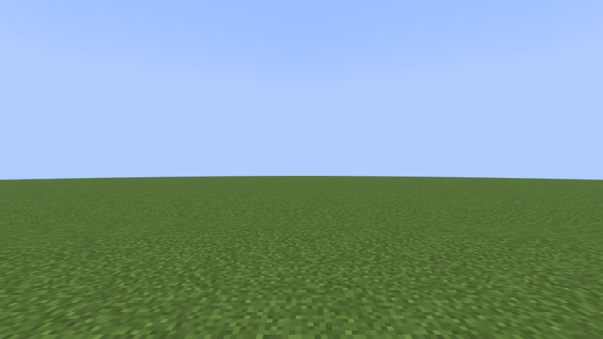

# rustcraft

The Minecraft Java Edition client (26.3), ported to Rust file by file from the decompiled game and checked against the real game at every step.

Created in [T3 Code](https://t3.codes).

## The prompt

This project started from this prompt:

> I want to re-create the Minecraft Client in Rust, wondering if we can setup the environment first.
>
> can we get the decompiled version of Minecraft Java (the latest version), I was thinking of doing a Java to Rust translation, but keeping the Java mannerism (like folder structures and etc).
>
> But i'm also scared of you getting some parts wrong, and even when I tell you to optimize properly, so I'm wondering what we can do here to fix it, maybe screenshots comparison (in a pixel perfect way?), comparing network packets to the original client and maybe even tests from the minecraft server client in C++
>
> what do you think here?

Then, on 2026-10-22, the goal:

> I want to re-create the Minecraft Client in Rust, focus on being able to join a Minecraft Server and rendering the world in a real GUI.
>
> Use the decompiled Minecraft Java in here for reference, and feel free to optimize or using any other library for rendering, like using one that does Metal (the apple thing) directly if possible.
>
> For validation, compare against the real Minecraft Java client, for example joining a test server, comparing if something is pixel perfect overtime (like in a video or a screenshot), opening GUIs, comparing network packets to the original client and see if they match and if needed, use the C++ Minecraft Server tests which focus a lot on physics of a Minecraft Bot client compared to the real thing, and maybe even do some of our own if you want to.
>
> The goal here is to get a better optimized version of the Minecraft Client from Java to Rust, like getting even more FPS while being equal to the Java one in everything. Feel free to have agents that compare each one, and see what's missing, a table in the readme describing the features and how the Rust port compares would be really nice.

## How it fits together

- **The port** lives in `src/`, mirroring Java's packages: `src/net/minecraft/util/mth.rs` is `net/minecraft/util/Mth.java`. [PORTING.md](PORTING.md) has the translation rules, including the places where Java and Rust disagree on numbers.
- **Vanilla is the oracle.** The real game runs alongside the port and the outputs get compared, from single functions up to screenshots. [TESTING.md](TESTING.md) has the layers and file formats.
- **The goal** is in [GOAL.md](GOAL.md): join a server and render the world in a real window, then match vanilla in packets, physics, pixels and screens while running faster. The work runs as parallel tracks (net, world, render, and later player, screens, performance and backends). [PROGRESS.md](PROGRESS.md) logs how far each has come.
- **Mojang's code and assets stay out of git.** `tools/setup_vanilla.py` downloads and decompiles them into `vanilla/`, which is gitignored, because they can't be redistributed. The Rust translation is derived from that code too, so think twice before making this repository public.

## Features

How the port compares with vanilla 26.3, area by area.

Coverage on `main` today (counted from the code and its checks by the comparison agent, 2026-10-23):
- **Gates** (GOAL.md): 1 of 6 reached, gate 1 (join). Gate 2's window has the terrain, sky, fog, the HUD's bars and movement, but not the hand; gate 3's walk has its trace and packets identical and its screenshots differ only in the first-person hand (and, after the walk, the targeted block's outline); gate 5 isn't measured.
- **Packets**: 106 of vanilla's 260 decoded. Handshake 1 of 1, status 4 of 4, login 10 of 11, configuration 26 of 31 (10 of 10 serverbound, 16 of 21 clientbound), play 45 of 144 clientbound and 20 of 69 serverbound. The rest are `Unported`: skipped by their frame.
- **Scenarios**: 21 in `oracle/scenarios/`. Offline, the 20 with replay tests (the walk and 19 physics scenarios) have vanilla's trace and packets from the marker, in CI. Live, 12 have their trace and packets identical and 5 pass `oracle-diff dir --strict` (`walk-no-gui`, `stairs`, `climbing`, `scaffolding`, `walls-and-panes`); the other 9 have no live run recorded.
- **Screenshots**: 2 of vanilla's 4 pixel-identical (`walk-no-gui`'s two); the `walk`'s two differ in 18,279 and 18,984 of 409,920 pixels, the hand and, after the walk, the block outline.
- **Blocks**: all 35,723 states have vanilla's ids, properties, shapes, light and render properties, and bake to vanilla's quads; the live client tours a generated world without a panic (`port_client.py soak`, in CI).
- **The rest**: all 161 entity types, but no entity class's client side; all 192 pipelines; the HUD's bars, but no text; none of vanilla's 127 `*Screen` classes drawn; no items, sound or interaction yet. Of the 89 rows below, 10 are done (some but for what they name), 36 partial, 42 not started and 1 not measured.

**Checked by** says how the port is compared with the real game ([TESTING.md](TESTING.md)), and for a row not started, the check it's meant to get:
- **goldens**: vanilla's own answers to the same calls, matched bit for bit;
- **traces**: tick-by-tick player state while both clients replay a scenario;
- **captures**: the packets each client sends to a vanilla server;
- **screenshots**: pixel-identical frames.

Every step of the loop updates this table.

| Area | Feature | Port | Checked by | vs vanilla |
| --- | --- | --- | --- | --- |
| Math | Java's `Math` (HotSpot's x86-64 `sin`, `cos`, `tan`, `log`, `pow`; FdLibm's `asin`, `acos`, `atan`, `atan2`, `hypot`), `Float.toString` and `Double.toString` (OpenJDK's Schubfach), `Mth` | Done | goldens | same bits |
| Math | JOML: the `Matrix4f`, `Vector3f`, `Quaternionf`… methods the client calls | Done | goldens | same bits |
| Math | Random sources (legacy, Xoroshiro128++, `nextGaussian`) | Done | goldens | same sequences |
| Core | `Vec3`, `Vec3i`, `BlockPos`, `Direction`, `AABB`, `Identifier`, `PoseStack`, `Transformation`, `ResourceKey`, `Registries` | Done but their DataFixerUpper `CODEC`s, and a few methods that take a `BoundingBox` or an `Entity`, whose golden cases are still pending | goldens | |
| Data | NBT: every tag, `NbtIo`, size accounting, SNBT `toString` | Partial: no SNBT parsing, no `HashMap` tree bins | goldens | |
| Data | Text components, DataFixerUpper codecs | Partial: DataFixerUpper's `DataResult`, `Lifecycle`, `DynamicOps` and `NbtOps`, `Codec`, `MapCodec` and the combinators text components reach; components on NBT (`ComponentSerialization.CODEC`, `Style` with colors, shadow, flags, click events but URLs and dialogs, shown text, insertions and fonts; literal, translatable and keybind contents, `getString` through `en_us`, `toString`); no JSON, scores, selectors, NBT or object contents, item or entity tooltips yet | goldens (1,500 components, 1,482 decodes) | |
| Data | Registries and tags: the synchronized registries the server sends, the known packs, `update_tags` | Partial: the 32 synchronized registries as their keys in id order (the biomes with their values), the known packs' exchange, `BuiltInRegistries`' blocks, entity types, block entity types and attributes; no other registry's values (they wait for the codecs); no tags: `update_tags` is `Unported`, and block and fluid tags answer from vanilla's data pack, which is what a vanilla server sends | goldens (the harness's registries, the walk capture's registry data), captures (`check-join walk`) | |
| Network | Byte layer: VarInt, `FriendlyByteBuf`, stream codecs, frames | Done | goldens | |
| Network | Compression | Done (zlib, through `flate2`) | unit tests, captures (`check-join walk --compression-threshold 256`) | join phase matches vanilla's with compression on |
| Network | Encryption, online-mode login | Not started: the port joins offline-mode servers, and leaves one that asks to encrypt | | |
| Network | Handshake | Done (1 of 1 packets) | goldens, captures | same bytes |
| Network | Server list ping | Partial: the status protocol (4 of 4 packets), `ServerStatusPinger`'s ping, `rustcraft --ping HOST:PORT`; the status is its JSON until text components come, and there's no legacy ping for pre-1.7 servers | goldens, captures (`capture walk --ping`) | same packets as vanilla's ping |
| Network | Login, offline mode | Partial: 10 of 11 packets (disconnect waits for text components, `Unported`) | goldens, captures | same packets |
| Network | Configuration | Partial: 10 of 10 serverbound, 16 of 21 clientbound (disconnect, resource pack push, server links, tags and dialogs are `Unported`) | goldens, captures | same packets |
| Network | Play | Partial: 45 of 144 clientbound (some handled only as far as the client's state is ported: the player's abilities, health, experience, attributes, synced data, motion and damage, the world border, the tick rate; entity data with 31 of 44 serializers), 20 of 69 serverbound; the rest are `Unported`: skipped, and answered by nothing | goldens (with the registries vanilla's server sends; the login packet is checked on vanilla's captured login) | |
| Network | Joining a server: `Connection`, the client's listeners, the tick loop, `--server HOST:PORT` | Partial: joins and stays (keep-alives, pings, known packs, teleports, chunk batches, bundles, `player_loaded`, going back to configuration), in a window or `--headless`; the player moves on the level the server sent | captures (`tools/port_client.py check-join walk`: `oracle-diff packets --join`) | gate 1: the join phase matches vanilla's, plain and compressed |
| Network | Server addresses: lookups, SRV records, the server blocklist | Partial: lookups like Java's (the handshake names `127.0.0.1` `localhost`); SRV and the blocklist not started | unit tests, captures | |
| Network | Chat and secure chat: chat from the server, `ChatListener`'s trust levels, message signing, profile keys, last-seen acknowledgements | Not started: `system_chat`, `player_chat`, `disguised_chat` and `delete_chat` are `Unported`, and nothing is signed (`chat`, `chat_session_update`, `chat_ack` aren't ported) | captures | |
| Network | Commands: the command tree (Brigadier, 62 argument types), suggestions, signed commands | Partial: `chat_command` (unsigned), which scenarios' setups send; `commands` and `command_suggestions` are `Unported`, and `command_suggestion` and `chat_command_signed` aren't ported | goldens (`chat_command`), captures (the scenarios' setups) | |
| Network | Server extras: cookies, transfers, the brand, custom payloads, resource packs from the server, server links, report details | Partial: cookies stored and answered (`store_cookie`, `cookie_request`, in login, configuration and play), the client's brand sent and the server's kept, `custom_report_details` kept; `transfer` disconnects (transfers aren't ported), `resource_pack_pop` is decoded and does nothing, and `resource_pack_push`, `server_links` and play's debug payloads are `Unported`, so a server's pack gets no `resource_pack` answer and nothing downloads | goldens (each packet), captures (the brand in `check-join walk`) | |
| World | Blocks and block states (1,286 blocks, 35,723 states) | Partial: every block and state with vanilla's ids, properties, default states and what each keeps from its `Properties` (light, occlusion, map colour, random ticks…) and its fluid state; everything `initCache` keeps (the light's occlusion shapes, skylight and dampening, the collision cache, `isFaceSturdy`, `isSolid`) and what the renderer and camera read (shade, render shape, `skipRendering`, seed, offset, the default predicates) for every state; no other behaviour yet: ticks, `use`, `updateShape`, and `animateTick`'s particles and sounds, which the client doesn't call (no particles or sounds yet) | goldens (every state), `blocks.json`; the live client on a generated world (`port_client.py soak`) | same ids, values, flags, light and render properties for all 35,723 states; no panic touring biomes, a village and caves |
| World | Chunk data, level storage, light | Partial: paletted containers, sections, `DataLayer`s, fluid states, `BitSet`, the chunk, light, forget, block update, section update and biomes packets, the client's chunk storage (`ClientChunkCache`, `LevelChunk`, `ClientLevel`'s blocks, behind `BlockGetter`), and its light (`LevelLightEngine` with the block and sky engines and their section storages, `ChunkSkyLightSources`, the handlers' queued light updates, light worked out where blocks change, behind `BlockAndLightGetter`); no block entities | goldens, on the walk's 117 chunks; the level read back block by block against vanilla's sections; vanilla's light engine fed the same packets and block changes (55 programs) | same block states, biomes, counts, heightmaps and light for every captured chunk; sections and light written back byte for byte; every light value, section state and sky source read back the same |
| World | Biomes and tints | Partial: the synchronized biome registry's values (climate and colours, read by temporary readers from the vanilla pack's JSON or the server's NBT until the codecs come), `BiomeManager`, the grass, foliage and dry foliage colormaps, `BiomeColors`, `BlockTintCache`, `ClientLevel`'s `calculateBlockTint` and `getBlockTint` with the blend radius, and `BlockColors.createDefault`; not the biomes' environment attributes (sky, fog, particles, sounds) or temperature at a block; the live client loads the colormaps once at startup (`GameRenderer`), with no resource reload | goldens: every biome of the walk's registry, the colormaps' pixels and lookups, the zoomed lookup, tints blended over the walk's chunks with biomes laid on them (4 layouts, radii 0, 2 and 7), `createDefault` for every tinted state | same values, pixels, quarts and tints |
| World | Environment attributes (sky and fog colours, the sun's angle, the light's colours…) from the dimension, the biomes, the timelines and the weather | Partial: the 41 attributes the client reads of the sky, fog, light, music and gameplay, their layers, modifiers, timelines and the camera's probe, from the vanilla pack's data; the rest of the attribute types not yet | goldens (1,044 cases over the three dimensions, 29 times and 4 weathers, 48 probe programs) | same values |
| World | Block entities | Partial: the 49 types (`BlockEntityTypes`) and the chunk packet's block entities, decoded and checked but not kept; no `BlockEntity` classes, `block_entity_data` or `block_event` (chest lids, note blocks, pistons) | goldens (the types; generated chunk packets with block entities) | |
| World | Time, weather and the tick rate | Partial: `set_time` sets the level's game time and the clocks the sky reads (`ClientClockManager`); the level doesn't advance them between updates (`ClientLevel.tickTime`); `game_event` is handled for the level's loading and the game mode only, so no rain or thunder; `ticking_state` and `ticking_step` are decoded and dropped (no `TickRateManager`: the port ticks 20 times a second) | goldens (the packets, `ClientClockManager`'s 400 programs) | |
| World | World border | Partial: a still border for collisions (`WorldBorder`'s `StaticBorderExtent`); `initialize_border` is decoded but not applied, the other five border packets are `Unported`, and nothing draws it (`WorldBorderRenderer`) | goldens (`initialize_border`) | |
| World | Items and their data components (`Item`, `ItemStack`; 1,658 items, 122 component types) | Not started: what holds an item waits for it (inventories, equipment, item entities, recipes, entity data's item stacks) | goldens | |
| Physics | Voxel shapes: `Shapes`, `VoxelShape` and its kinds, joins, `collide`, face occlusion, rotation (`OctahedralGroup`, `rotateAttachFace`), `toString` | Done | goldens | same bits |
| Physics | Blocks' shapes (`getShape`, `getCollisionShape`, `getVisualShape`, `getBlockSupportShape`, `getInteractionShape`, `getOcclusionShape`) | Done for every block class, with the contexts the client passes (an entity's: descending, its bottom, its held item, falling, powder snow walkers, fluid standers); a shulker box's open lid and a moving piston's block wait for block entities (answered as without one) | goldens: every state (35,723) with no level around, every block under 9 more contexts and at 6 more blocks, offsets | same shapes |
| Physics | Fluids as entities feel them: heights, flows, currents, shapes, `EntityFluidInteraction`; ray casts (`BlockGetter.clip`, `ClipContext`) | Partial: water and lava's heights, flows (falling water down solid faces) and shapes, the currents' push; no ticking or spreading | traces of `water`, `water-current`, `falls` | identical |
| Player | Input, movement, collisions: walking, jumping, sprinting, sneaking (and backing off edges), friction, speed factors, step-up, stairs, slabs and walls, falling (any height), wading, swimming (sprint-swimming's pose), sinking, currents, getting out of water, climbing ladders, vines and scaffolding | Partial: the local player's movement, in the live client and offline; gliding, bouncing, lava's damage and powder snow panic until ported | traces and packets of the walk and 19 physics scenarios (below), goldens (22,049 cases) | every scenario's trace and packets from its start identical, bit for bit and byte for byte |
| Player | The server's answers to the player: its motion (`set_entity_motion`), damage (`damage_event`, `hurt_animation`), health (`set_health`), synced data and attributes | Partial: the local player's; other entities' wait for entities | goldens of the packets; `falls`' trace, where the scenario waits for them (`wait_for`) | identical |
| Player | What a moving player sends: `move_player_*` (and its reminder), `player_input`, `player_command`'s sprinting, `client_tick_end`, in `Minecraft.tick`'s order | Done for walking players (riding isn't ported) | the scenarios' packets from the marker on, offline and live (`oracle-diff dir --strict`'s packets part) | identical |
| Player | Attributes (`AttributeMap`, `AttributeInstance`, modifiers) | Partial: the 12 attributes movement reads; two modifiers of one operation aren't ordered like Java's yet | goldens (1,500 programs) | same values |
| Player | Flight, game modes and abilities | Partial: the game mode the server sets (`MultiPlayerGameMode.setLocalMode`, from the login and `game_event`); `player_abilities` is decoded but not applied, creative flight (`mayfly`) panics in `aiStep`, and spectators' no-clip isn't ported | goldens (the packets) | |
| Player | Riding: boats, minecarts, horses, camels, pigs, striders, happy ghasts | Not started: `set_passengers`, `move_vehicle` and `paddle_boat` are `Unported`, and there's no vehicle input or jump bar | traces | |
| Player | Effects, experience, death and respawn, sleeping | Not started: `set_experience` is decoded but not kept; `update_mob_effect`, `remove_mob_effect`, `respawn` and `player_combat_kill` are `Unported`, so effects that change movement (speed, jump boost, levitation, slow falling) don't | traces, screenshots | |
| Interaction | Attacking and breaking blocks: `MultiPlayerGameMode`'s attack and destroy progress, the attack cooldown, `swing`, `player_action` | Not started | traces, captures | |
| Interaction | Placing blocks and using items: `Minecraft.pick`'s hit result, `use_item_on`, `use_item`, the block state predictions (`block_changed_ack`) | Not started | traces, captures | |
| Interaction | The hotbar and held items: scrolling and number keys (`set_carried_item`), picking blocks (`pick_item_from_block`), dropping, swapping hands | Not started: `set_held_slot` is decoded, with no inventory to select in | captures | |
| Interaction | Containers: the player's inventory, `AbstractContainerMenu`, clicks (`container_click`), `open_screen`, slots and data, creative slots, villager trades | Not started | captures, screenshots | |
| Interaction | Crafting and the recipe book: recipes (`update_recipes`, `recipe_book_add`), ghost recipes (`place_recipe`), the book's tabs and search | Partial: the recipe books' settings (`recipe_book_settings`) are kept; the rest is `Unported` | goldens (`recipe_book_settings`, 3,591 cases) | |
| Entities | Entity types and the level's entities (`EntityType`, `add_entity`, `remove_entities`) | Partial: the entity types (`EntityType`, all 161 of `EntityTypes`, `BuiltInRegistries.ENTITY_TYPE`), the level's other entities (`add_entity`, `remove_entities`, the lookup and tick list, `recreateFromPacket`), each a plain entity of its type: no class's tick, no moves or interpolation yet, so only still entities are where vanilla has them | goldens (every type's values, `EntityType.STREAM_CODEC`, the two packets: 24,932 and 5,542 cases); traces of `entities` | same types, dimensions, tracking ranges and update intervals; still entities' positions identical |
| Entities | Moving entities: moves, teleports, position syncs, head rotations, interpolation, passengers, leashes, pushing | Not started: other entities stay where `add_entity` put them | traces | |
| Entities | Each class's client side: other players (`RemotePlayer`, `player_info_update`), mobs by family, projectiles, vehicles, items, XP orbs, falling blocks, paintings, item frames, armor stands, displays; equipment (`set_equipment`), animations (`animate`), `entity_event`'s effects | Not started: each entity is a plain `Entity` of its type | traces | |
| Rendering | Window (SDL3) and input | Partial: the window and OpenGL 3.3 core context made like vanilla's (LWJGL's own SDL3 build), the level drawn in it each frame; WASD, jump, sneak and sprint by their default keys, mouse look (a click grabs the mouse, Escape lets go), F1; no screens, key bindings or other keys yet; no resizing (the main target keeps its first size), fullscreen, VSync or frame rate limit | device as vanilla logs it, on llvmpipe | same driver, flags and extensions as the oracle's log |
| Rendering | renderpearl with its OpenGL backend, shaders through shaderc and SPIRV-Cross | Partial: every pipeline of `RenderPipelines`, compiled through vanilla's own shaderc and SPIRV-Cross builds and linked into GL programs with their uniform blocks and samplers; the GL device, textures, samplers, buffers, vertex arrays, render passes that clear and draw (`FrontendRenderPass`, indexed and not, and indirect multi-draws), `BufferBuilder`, std140 uniform blocks, screenshots read back; no push constants or direct multi-draws yet | goldens (SPIR-V, reflection, bindings, GLSL); frames under Xvfb | SPIR-V and GLSL byte-identical for all 192 pipelines, all 192 link on llvmpipe; GUI fills pixel-exact against their known pixels |
| Rendering | Metal backend (macOS) | Not started | draw stream checked against OpenGL's | |
| Rendering | Vulkan backend | Not started | screenshots, against vanilla's Vulkan backend | |
| Rendering | Resources, texture atlases, block models | Partial: the vanilla pack and the client's resource manager; PNGs decoded by LWJGL's own stb; the block atlas (sprite sources, `.mcmeta` animations and texture sections, `Stitcher`, `MipmapGenerator`, `TextureAtlas` drawn on the GPU) and the item atlas's sprites (with `paletted_permutations`); block models baked for every block state (model JSON through Gson's tree, parents and `#` textures, variants, multipart, weights, rotations, uvlock, `FaceBakery`, the missing model); no item models, other atlases or item atlas upload yet | goldens; atlas frames under Xvfb | all 3,964 textures decode to vanilla's pixels; the block atlas's layout and all 1,310 sprites' mip levels match vanilla's, and the GPU atlas's five levels are exactly those sprites drawn; every one of the 35,723 block states bakes to vanilla's quads, bit for bit |
| Rendering | The level's frame: terrain, the sky disc, fog | Partial: the level drawn like vanilla's frame on llvmpipe: the camera at the player's eye, the culling frustum, the occlusion graph and its octree, sections compiled like `SectionCompiler` with the biomes' tints and drawn by indirect multi-draws, the lightmap, the sky disc, the atmospheric fog, all from the level's light and its environment attributes; no fluids, block entities, sun, moon, stars, sunrise, clouds, weather or world border yet | goldens (vertex and index bytes, the camera's rotation, the frustum's culling, the attributes); screenshots of the walk's two views (`tests/opengl_frame.rs` checks the spawn view's digest on the oracle machine's Mesa; CI's Mesa differs, so there it only renders) | both GUI-free walk screenshots identical (`oracle-diff dir --strict` exits 0) |
| Rendering | The rest of the sky and fog: the sun, the moon, the stars, the sunrise fan, the End's sky; fog in water, lava, powder snow, blindness and darkness | Not started: the stars and the sunrise fan panic when they'd be drawn (at night, dawn and dusk); of the fog environments only the atmospheric one is ported | screenshots | |
| Rendering | Fluids (`FluidRenderer`) | Not started: a section with water or lava panics when it compiles | goldens (vertex bytes), screenshots | |
| Rendering | Clouds, rain, snow and lightning (`CloudRenderer`, `WeatherEffectRenderer`) | Not started | screenshots | |
| Rendering | Block entities (`BlockEntityRenderDispatcher`, 33 renderers: chests, signs, banners, skulls, shulker boxes, bells, beacon beams, end portals, enchanting tables' books, lecterns, campfires, conduits, spawners, vaults, decorated pots…) | Not started | screenshots | |
| Rendering | Entities (`EntityRenderDispatcher`, 136 renderers and 51 layers, the entity models by family, the player model with skins, capes and armor, shadows, name tags, leashes, hitboxes) | Not started | screenshots | |
| Rendering | Items and maps: item models (`ItemModelResolver`, `ClientItem`, the 17 special renderers), items in the GUI (`GuiItemAtlas`), on the ground and in frames; maps (`MapRenderer`, `map_item_data`) | Not started: the item atlas's sprites load (some block models' particles are item sprites), but aren't uploaded | goldens, screenshots | |
| Rendering | First-person hand: `FirstPersonHandsAndItemsRenderer`, the arm in the player's skin, items in hand, swinging, equipping, eating, the map in hand | Not started | screenshots (the `walk`'s: most of what still differs is the hand) | |
| Rendering | The block outline, the breaking animation, debug renderers (chunk borders, hitboxes, gizmos) | Not started | screenshots | |
| Rendering | Particles (`ParticleEngine`, 88 particle classes for 128 types: `level_particles`, block breaking, weather and ambient particles) | Not started | screenshots | |
| Rendering | Post effects and screen overlays: `PostChain` (spectating a creeper, spider or enderman, glowing entities' outlines), `ScreenEffectRenderer` (in a wall, underwater, on fire), the vignette, pumpkin, portal, nausea, freezing and spyglass overlays | Not started: `post_effects` is decoded and dropped | screenshots | |
| Rendering | Font: `FontManager`; the bitmap, space, TrueType and unihex providers; `Font`'s layout, shadows and obfuscation; the glyph atlas | Not started | goldens, screenshots | |
| Rendering | GUI drawing: `GuiGraphicsExtractor`, `GuiRenderState`'s strata and layers, `GuiRenderer`, the GUI atlas | Partial: fills, gradients, blits, sprites stretched, tiled and nine-sliced as their `gui` sections say, scissors and the pose, sorted and batched into draws like `GuiRenderer`'s; no text, items, pictures in pictures, the blur or the panorama yet | goldens (400 two-frame `GuiRenderState` programs, 5,833 `ScreenRectangle` cases, every GUI sprite's scaling, the GUI atlas's layout); screenshots | same draw order, bounds and vertex bytes; same atlas |
| HUD | Hotbar, crosshair and status bars (`Gui`, `Hud`) | Partial: the crosshair, the hotbar and its selection, hearts (blinking, jitter, absorption), food (with its jitter), armor, air bubbles and the experience bar, with the HUD's tick-seeded random; no text (the experience level, the held item's name, overlay messages, titles), items in the slots, chat, mob effects, the vignette or the attack indicator yet; the locator and jumpable vehicle bars come with waypoints and vehicles | screenshots (walk) | the walk's spawn identical but for the first-person hand (0 pixels outside it); after the walk, the hand and the targeted block's outline (render track) |
| HUD | Chat, titles, the action bar and subtitles: `ChatComponent`, the chat screen (`ChatScreen`, `CommandSuggestions`), the title packets, `SubtitleOverlay` | Not started | screenshots (gate 4's chat) | |
| HUD | Boss bars, the scoreboard, the player list and toasts: `BossHealthOverlay` (`boss_event`), the sidebar and teams (`set_objective`, `set_score`, `set_player_team`), `PlayerTabOverlay` (`player_info_update`, `tab_list`), `ToastManager`, the tutorial's hints | Not started | screenshots | |
| HUD | The debug overlay (F3): `DebugScreenOverlay`'s 37 entries, the frame time, TPS, ping and bandwidth charts, the profiler's pie, F3's key combinations | Not started | screenshots (gate 4's F3) | |
| Screens | Widgets, layouts and navigation (`gui/components`: buttons, sliders, edit boxes, lists, tabs, tooltips; `gui/layouts`, `gui/navigation`, `gui/narration`) | Not started | screenshots | |
| Screens | The title screen and loading: `TitleScreen` with the panorama, logo and splash, `LoadingOverlay` during the resource reload, the first launch's `AccessibilityOnboardingScreen` | Not started | screenshots | |
| Screens | Options and its sub-screens: video, sound, controls and key binds, mouse, chat, skin customization, accessibility, language, fonts, online, telemetry, pack selection, credits | Not started | screenshots | |
| Screens | Multiplayer: the server list, direct connect, editing a server, connecting, disconnected, the code of conduct | Partial: `ConnectScreen`'s connection without the screen (resolved and joined on the game's thread), the server list's ping (`rustcraft --ping`); no `JoinMultiplayerScreen`, `servers.dat`, LAN list or `DisconnectedScreen` (the port exits 1 with the reason), and a code of conduct not yet accepted is printed and left unanswered | captures (`check-join walk`, `capture walk --ping`) | |
| Screens | In-game menus: pause (Escape lets go of the mouse instead), death, the credits and the end poem, level loading, sleeping, the game mode switcher (F3+F4) | Not started: `LevelLoadTracker` is in, without its screen | screenshots (gate 4's pause menu) | |
| Screens | The inventory and the creative inventory: the player model, effects, item tooltips, creative tabs and search | Not started | screenshots (gate 4's inventory) | |
| Screens | Container screens, for 25 menu types: chests, barrels, shulker boxes, crafting table, crafter, furnaces, anvil, enchanting, brewing, beacon, villager trading, grindstone, loom, smithing, stonecutter, cartography, hopper, dispenser, lectern, horse and nautilus inventories | Not started | screenshots | |
| Screens | Books, signs and block editors: reading, writing and signing books, sign and hanging sign editing (`open_sign_editor`, `sign_update`), command, structure, jigsaw and test blocks | Not started | screenshots, captures | |
| Screens | Advancements and statistics (`update_advancements`, `award_stats`) | Not started | screenshots | |
| Screens | Server dialogs and links (`show_dialog`, `server_links`) | Not started: `clear_dialog` is decoded and `custom_click_action` ported; `show_dialog` and `server_links` are `Unported` | goldens (the packets) | |
| Screens | Singleplayer and LAN: the integrated server, world selection, creation (presets, game rules, experiments), editing, backups, opening to LAN, LAN discovery | Not started (the brief is about joining servers) | | |
| Sound | The sound engine and what plays: OpenAL (`com/mojang/blaze3d/audio`), `SoundManager`, `sounds.json`'s 1,991 events, Ogg streams, the server's `sound`, `sound_entity` and `stop_sound`, the client's own (footsteps, blocks, clicks, minecarts, elytra) | Not started | | |
| Sound | Music and ambience: `MusicManager` (from the environment attributes' music, which the port reads), biome, underwater and bubble column ambience | Not started | | |
| Client | Options and key bindings: `options.txt`, `KeyMapping`s bound to keys, toggles, mouse settings | Partial: `Options`' defaults (what `client_information` tells the server, the render distance, the biome blend radius, the mouse sensitivity, the GUI scale, the vignette) and the movement keys held by their default keys; no `options.txt`, rebinding or toggles | captures (`client_information` in `check-join walk`'s join phase) | same `client_information` as vanilla's defaults |
| Client | Languages and accessibility: `LanguageManager`, the narrator, high contrast, text backgrounds | Partial: `Language` from `en_us.json` and `deprecated.json`, for translated components; no other language, no narrator | goldens (`ComponentSuite`'s `getString`) | |
| Client | Resource packs and the resource reload: the pack repository, user and server packs, F3+T | Partial: the vanilla pack (`VanillaPackResources`, `MultiPackResourceManager`), loaded once at startup with the models, atlases and colormaps; no pack repository, other packs or reload | goldens (`TextureSuites`: the same resources listed in the same order) | |
| Client | Screenshots: F2, the screenshots folder, panoramic screenshots | Partial: `Screenshot.takeScreenshot`'s read-back, which scenarios' screenshots use; no F2 or saving | frames under Xvfb (`reads_back_frames_the_right_way_up`) | |
| Services | Skins and capes: `SkinManager` fetching textures from Mojang's servers, `DefaultPlayerSkin` | Not started: the game profile's properties are kept (`GameProfile`, `PropertyMap`) | | |
| Services | Realms (`com/mojang/realmsclient`, 28 screens) | Not started | | |
| Services | Telemetry, social interactions, player reports, friends and presence (26.3's friends overlay), ban notices | Not started | | |
| Performance | FPS, frame time, chunk-meshing throughput | Not measured | benchmark scenario | |

### Physics scenarios

Gate 4's physics, in `oracle/scenarios/`: each builds its course on the flat world with `setup` commands, and its tick trace and serverbound packets from the scenario-start marker on are compared with vanilla's run (TESTING.md, "Offline replays"). **Offline** is the port's player replayed without a server, on the flat level with the course's blocks (CI) and on the level the server sent (where a capture is); **live** is `tools/port_client.py capture <scenario>` on a vanilla server, compared with `oracle-diff dir --strict`.

| Scenario | What it covers | Offline | Live |
| --- | --- | --- | --- |
| `walk` | walking from a standstill, a jump, sprinting, sneaking sideways, a fixed look | identical | trace and packets identical (CI checks them); the screenshots differ only in the first-person hand (18,279 of 409,920 pixels at spawn, none outside it) and, after the walk, the hand and the targeted block's outline (18,984), which aren't ported |
| `walk-no-gui` | the walk with the GUI hidden (F1), its screenshots the level alone | identical | identical: trace, packets and both screenshots (`oracle-diff dir --strict` exits 0) |
| `surface-concrete` | walking, sprinting, sprint-jumping, sliding to a stop, sneaking, jumping and backing up on concrete | identical | |
| `surface-packed-ice` | the same on packed ice (friction 0.98) | identical | |
| `surface-blue-ice` | the same on blue ice (friction 0.989) | identical | |
| `surface-soul-sand` | the same on soul sand (its 14-sixteenths collision shape and 0.4 speed factor) | identical | |
| `surface-transitions` | walking and sprint-jumping across packed ice, soul sand, concrete and blue ice in a row | identical | |
| `block-steps` | walking into a block, jumping up a staircase of whole blocks, dropping two blocks off it | identical | trace and packets from the marker identical; two of the server's light updates differ (`--strict` exits 1) |
| `stairs` | walking up oak stairs half a block at a time, sprinting up, walking and sneaking back down | identical | identical (`oracle-diff dir --strict` exits 0: the scenario takes no screenshots), again with the setup waiting for each command's blocks |
| `walls-and-corners` | running into a wall (sprint stops), sliding along it at an angle into a corner, pushing into the corner | identical | |
| `fall` | walking off a ledge onto a slab, off the slab onto soul sand, sprint-jumping on | identical | |
| `low-ceiling` | jumping into a ceiling two blocks up, standing, walking and sprinting | identical | |
| `sneak-edge` | sneaking to a ledge and along it without falling, then walking off | identical | |
| `slabs-and-fences` | stepping up a slab and a double slab, crouching into a gap of one and a half blocks under top slabs (and staying crouched), walking into a fence and failing to jump it | identical | trace and packets from the marker identical; with the setup waiting for each command's blocks, its block updates now match, but the run ends just after the player crosses into a new chunk, whose `set_chunk_cache_center` and chunks vanilla caught and the port didn't, and a light update differs (`--strict` exits 1) |
| `water` | walking into a pool and sinking, swimming up with jump to the surface and bobbing, sneaking down, sprint-swimming (the swimming pose) down and up, floating, swimming to the edge and jumping out onto the bank | identical | trace and packets from the marker identical; the clientbound packets differ by the server's own clock (the player's air under water, `set_entity_data` every server tick), so `oracle-diff dir --strict` exits 1 |
| `water-current` | wading into a stream of flowing water levels and being carried, walking against it, a waterfall pushing down, jumping in it | identical | trace and packets from the marker identical; the clientbound packets differ by the air under water and the server's light updates (`--strict` exits 1) |
| `climbing` | climbing a ladder by walking into it, sliding down, holding sneak to stop, climbing with jump, then a vine the same way | identical | identical (`oracle-diff dir --strict` exits 0) |
| `scaffolding` | climbing scaffolding with jump, standing on its top, sneaking down through it, a bottom scaffolding's frame to step on | identical | identical (`oracle-diff dir --strict` exits 0) |
| `walls-and-panes` | walking into a low cobblestone wall and failing to jump it, sliding along it into a tall post, walking along glass panes and around a lone pane post, sprint-jumping on | identical | identical (`oracle-diff dir --strict` exits 0) |
| `entities` | two pigs (`NoAI`) and an armor stand (`NoGravity`) summoned out of the player's way, in the trace each tick while the player walks and stops | identical | trace (with the entities' positions) and packets from the marker identical; the summoned entities' UUIDs are random, so their `add_entity` and the summons' chat differ (`--strict` exits 1) |
| `falls` | falling 3 blocks (no damage), 5 blocks onto stone and 10 onto hay bales (damage), each landing waiting for the server's answer (`wait_for`) | identical (on vanilla's capture; CI on the port's) | trace and packets from the marker identical (CI checks them); the server's answers to the damage differ from run to run, and its light updates (`--strict` exits 1) |

Not covered yet: slime and honey (bouncing and sliding), lava (whose damage comes on the server's clock), a water landing, trapdoors as ladders, and moving entities.

## Getting started

Needs Python 3.12+, Rust, about 2 GB of disk, and `xvfb` with Mesa's llvmpipe (`sudo apt install xvfb libgl1-mesa-dri`) for the oracle client and the port's OpenGL tests. The scripts download their own JDK.

```sh
python3 tools/setup_vanilla.py          # download, decompile (authlib too), fetch JOML's, Netty's and Guava's sources, run the data generator
python3 tools/golden.py                 # record vanilla's answers for the golden tests
cargo test                              # check the port against them
python3 tools/oracle_client.py run walk # replay a scenario in the real client
cargo run --release -- --server HOST:PORT --username rustcraft   # join a server (offline mode) and walk around in a window
cargo run --release -- --render-scenario oracle/scenarios/walk-no-gui.json --capture CAPTURE --screenshot out.png
                                        # the scenario's view of the level a capture fills, offscreen, no server
cargo run --release -- --ping HOST:PORT                          # ping it like the server list, printing its status
python3 tools/port_client.py capture walk --accept-eula          # the port's run of a scenario on a fresh vanilla server
python3 tools/port_client.py check-join walk --accept-eula       # gate 1: that run's join phase against vanilla's
```

The client takes vanilla's own options where they exist (`--username`, `--uuid`, `--quickPlayMultiplayer HOST:PORT`, which `--server` is the same as), and `--headless`, which runs it without a window (it renders offscreen only for a scenario's screenshots). In the window, click to grab the mouse and look around, walk with W, A, S and D, jump with space, sneak with left shift, sprint with left control, hide the HUD with F1 and let go of the mouse with Escape. It stays in the world until the server disconnects it or the window is closed, and exits 1 with the reason when the server disconnects it.



`MINECRAFT_VERSION` pins the game version. Pass another version to `setup_vanilla.py` to study an update next to it.

| Path | What it is |
| --- | --- |
| `src/` | The port. `src/java/` holds JDK behaviour the game relies on (`Math`, `String.hashCode`, `UUID`), `src/org/joml/` the parts of JOML, the game's vector and matrix library, that the client calls, `src/io/netty/` the parts of Netty's buffers, `src/com/google/` Guava's, `src/com/mojang/authlib/` the player profiles of Mojang's authlib, and `src/org/lwjgl/` LWJGL's bindings to shaderc, SPIRV-Cross and SDL3, whose libraries come from vanilla's natives jars at runtime. `src/com/mojang/renderpearl/` is the renderer. |
| `oracle/golden/` | Java harness that calls real game methods and records the answers |
| `oracle/client/` | Fabric mod that drives the real client headless: tick traces and screenshots |
| `oracle/scenarios/` | Scripted inputs both clients replay |
| `tools/packet-proxy/` | Records client ↔ server traffic with each packet decoded |
| `tools/oracle-diff/` | Compares traces, packet captures and screenshots between two runs |
| `tools/*.py` | Setup, golden recording, vanilla server and oracle client runners, and a check for ports of HotSpot's assembly |
| `vanilla/` (gitignored) | Decompiled source, assets, data reports, jars, JDK, oracle outputs |
